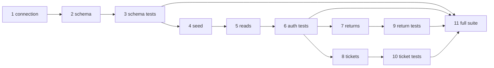

# Database checkpoint plan

Source: [PROJECT_STATUS.md](PROJECT_STATUS.md) and [docs/02_database_implementation_plan.md](docs/02_database_implementation_plan.md) Section 7. Schema details live in [docs/01_database_design.md](docs/01_database_design.md) Section C. Each step waits for the one before it. Do not start a later checkpoint until the current one is approved.

**Done:** Checkpoint 1, [app/db/connection.py](app/db/connection.py). Every later file must use `get_connection()` (foreign keys on, `sqlite3.Row`).

**Next authorized work:** Checkpoint 2 only. Stop there for review. Checkpoints 3–11 stay unstarted until 2 is approved.

## What each checkpoint does

- **1 — connection (done).** One function opens SQLite, turns foreign keys on, checks they are on, and returns rows as `sqlite3.Row`. Failures become `ConnectionError_`.
- **2 — schema.** [app/db/schema.py](app/db/schema.py) creates five tables, in order: `customers`, `orders`, `order_items`, `return_requests`, `support_tickets`. Money is integer paise. Times are UTC ISO-8601 text. Composite foreign keys stop a return or ticket from pairing an order with the wrong customer, or an item with the wrong order. CHECKs cover status values and the refund rule (amount is null only when refund is “Not Applicable”). Pass: tables create with no error, and a hand-inserted return with a mismatched `(order_id, customer_id)` is rejected. That hand check needs a few temporary rows, because seed data does not exist yet.
- **3 — schema tests.** [tests/test_schema.py](tests/test_schema.py) automates the hand check from 2, plus the refund CHECK, plus “foreign keys are actually on.” Tests 5b, 11, and 12 from design doc Section K.
- **4 — seed.** [app/db/seed_data.py](app/db/seed_data.py) fills a fresh database with synthetic data. Fixed case: C101 owns ORD1001 (Delivered, inside the 7-day window) and ORD1002; C102 owns ORD1003. Also about 6 customers and the status coverage in design doc Section J. Dates are offsets from an injected “now,” not the real clock. Every `product_id` must exist in `Products.json` or the script stops. Do not edit `Products.json`. Re-running with the same “now” yields the same rows.
- **5 — read functions.** In [app/db/repository.py](app/db/repository.py): `list_customer_orders`, `get_order`, `get_order_items`, `get_customer_returns`, `get_customer_tickets`. Each takes the logged-in customer id and filters in SQL. Someone else’s order looks the same as a missing order: `None` or an empty list. Spot check: `get_order("C101", "ORD1003")` is `None`.
- **6 — auth tests.** [tests/test_authorization.py](tests/test_authorization.py) proves a customer only sees their own orders, items, returns, and tickets (tests 1, 2, 2b, 3, 4, 6). This must pass before any chat orchestrator or Streamlit UI.
- **7 — create return.** `create_return_request` writes one return inside a transaction, or returns a named result: `not_found`, `item_mismatch`, `outside_window`, or `duplicate`. No raw SQLite error leaves the function. Windows: 7 days, or 48 hours if damaged or wrong item. “Now” is an injected time.
- **8 — create ticket.** `create_support_ticket` always creates the ticket. If the given order is not that customer’s, the ticket is saved with `order_id` empty. It does not say the order belongs to someone else.
- **9 — return tests.** [tests/test_returns.py](tests/test_returns.py) covers bad item/order pairs, both time windows (inside and expired), and a second return on the same item.
- **10 — ticket tests.** [tests/test_tickets.py](tests/test_tickets.py) covers a ticket whose order id is not owned: row exists, `order_id` is null.
- **11 — full suite.** Run all four test files with pytest. No skips. Review the real output.

## Rules that apply the whole way

- Identity comes from the app session, never from the chat message.
- Composite foreign keys keep rows consistent. They do not replace the customer filter in SQL.
- No payment or shipment tables. Catalog stays in `Products.json`.
- Open items that do not block Checkpoint 2: return and ticket status enums still need sign-off; no non-returnable product in the catalog, so that path is not seeded unless resolved before Checkpoint 4.

## After this database phase

Still later, and not part of these checkpoints: RAG over FAQ and Policies, LangGraph orchestrator, Streamlit chat, a larger eval set, Docker, report, and deck.
