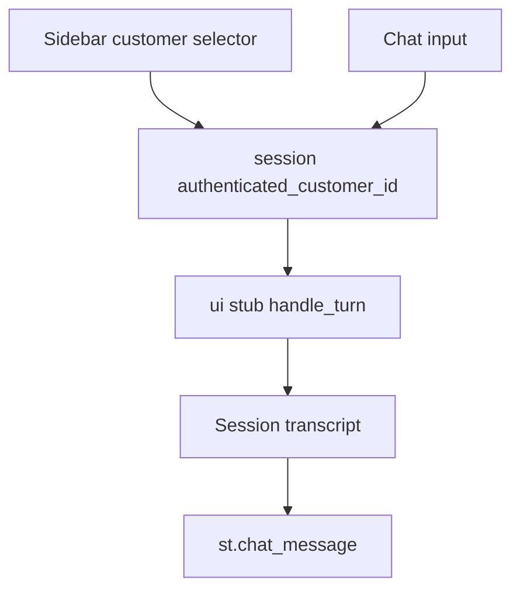

# Streamlit frontend plan

This plan is the chat page only. Schema, seed data, repository functions, authorization tests, RAG, and the real orchestrator are on a teammate's branch. Do not add or change `app/db/`, `tests/test_schema.py`, `tests/test_authorization.py`, or `app/orchestrator/`.

Source for the screen: [README.md](README.md) sections 3 and 5, and [docs/00_project_discovery.md](docs/00_project_discovery.md) sections 7–9. Text chat only. Voice, cart, checkout, catalog browsing, and real passwords stay out.

The page stores who is logged in and the transcript. It does not open SQLite, read `Products.json`, or call an LLM. Replies come from a small stub in the UI package with this signature, so the real orchestrator can replace it later without changing the widgets:

```python
def handle_turn(authenticated_customer_id: str, message: str, history: list[dict]) -> str
```

`authenticated_customer_id` is the session value. The stub echoes that id in its reply. It must not read a customer id out of `message` or `history`. It must not say a return or ticket was created.



## What the screen shows

- **Sidebar.** Label it as a simulated login, not a real account system. A select box lists a fixed demo pair used by the seed contract: C101 and C102, with display names. Show the active `customer_id`. A control clears the chat. A short line states that data is synthetic. The list is a constant in the UI package. Do not query the database for it.
- **Main column.** Title, then `st.chat_message` bubbles, then `st.chat_input`. Before a customer is chosen, the input stays disabled and the page asks them to pick a customer. After login, a short assistant greeting names that customer and offers example questions (order status, return, policy, product).
- **Replies.** The assistant bubble is the string the stub returns. If the call raises, show a short failure line and leave the transcript without a success claim.
- **Switching customers.** Changing the select box sets a new `authenticated_customer_id` and clears `messages`. History stays in the Streamlit session and is not written anywhere else.

## Steps

1. **[DONE] Add Streamlit with uv.** `uv add streamlit`. Do not create a second virtualenv and do not add a SQLite package. Launch with `uv run streamlit run app/ui/streamlit_app.py`.
2. **[DONE] Add the UI package.** New files: [app/ui/__init__.py](app/ui/__init__.py), [app/ui/session.py](app/ui/session.py), [app/ui/client.py](app/ui/client.py), [app/ui/streamlit_app.py](app/ui/streamlit_app.py). `session.py` holds the session keys (`authenticated_customer_id`, `messages`), the rule that a customer change clears `messages`, and the check that chat is blocked until an id is set. `client.py` is the stub `handle_turn`. Keep Streamlit widgets in `streamlit_app.py` so the session rules can be tested without a browser.
3. **[DONE] Build the sidebar selector.** Options come from the fixed C101 / C102 list. On change, update session state and clear the transcript. Do not accept a typed customer id in the chat box.
4. **Build the transcript.** On submit: append the user turn, call `handle_turn(session customer id, text, prior messages)`, append the returned string as the assistant turn, rerun. Pass the session id as its own argument. Do not put it inside the user message for the model to pick up.
5. **Document how to run it.** Add the `uv run streamlit run ...` command to [README.md](README.md) section 10, plus the simulated-login note already stated in section 3. Note that live order, return, policy, and ticket answers arrive when the teammate's branch supplies the real `handle_turn`.

**Progress:** Steps 1–3 are complete. The selector starts with no customer selected, offers only C101/C102, shows the active customer ID, and clears chat history on customer switch. Streamlit AppTest verified the unselected initial state, login as C101, and switch to C102 with history cleared. Step 4 is pending approval.

## Checks

- `uv run python -c` import of `app.ui.session` and `app.ui.client` succeeds.
- A small pytest on `app/ui/session.py` and `app/ui/client.py`: no customer id means chat is closed; switching id drops prior messages; the id the stub reports is the session id even if the user text names another customer (type C102 while logged in as C101).
- Browser pass: select C101, send a message, see the stub reply, switch to C102, confirm the old transcript is gone and the sidebar shows C102.

## Later swap

When the other branch is merged, point the page at `app.orchestrator.handle_turn` and delete the stub. The widgets, session keys, and customer-switch rule stay as they are. Order-status, not-found, return, policy, and escalation checks belong to that integration, not to this plan.
