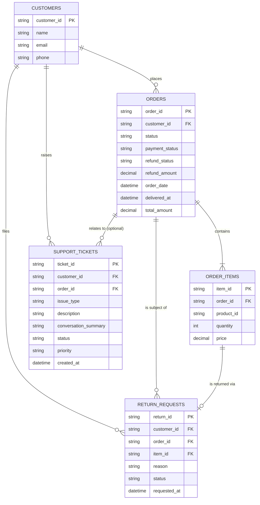

# Database Design — AI E-Commerce Customer Support Assistant

**Phase:** 1 — Database Design
**Status:** Phase 1 design approved. Checkpoint 2 (`app/db/schema.py`) implements Section C and was approved on 2026-11-06. Checkpoint 7A (the write-function contracts in Sections F, G, and H) is approved and was committed and pushed in `8ce2d43`. Those functions are **implemented** (`6a2c11a`, `app/db/repository.py`) and tested (`0f27739`). Database Checkpoints 1–10 are complete. See "Implementation status" below. **D2 contract freeze (approved by Person A in the master handover, 2026-11-11):** this document records the approved D2 design in Sections C, E, F, G, I, K and L: a persisted `reason_category` column, exact-text reason and ticket-text validation, canonical timestamp constraints, `RET_`/`TKT_` identifiers, the new eligibility outcomes and precedence, the `utc_now()` clock, `user_version` 0/1/>1 with fresh-database-only policy, three connection factories and the health states. **D2 is implemented** (checkpoints D3 to D8, commit on `rukum/db`, 2026-11-12); the "Implementation status" block below describes the code. Sections labelled "Legacy" describe the pre-D2 contract, which is superseded and no longer implemented.
**Scope of this document:** design. It was written under the Phase 1 task boundary (no application code, migrations, seed scripts, UI, RAG, LangGraph, or voice work); that sentence describes the original task, not the current repository, which now contains the implementation described below. Checkpoint 7A changed the write contracts only; it did not change Section C.

**Implementation status (2026-11-12, reconciled with the code in the database commit on `rukum/db`).** This block reports what exists in `app/db/`. The D2 contract frozen in this document is implemented. Where an older paragraph below is labelled "Legacy", it describes the pre-D2 code and is kept for history only.

- **Tables (`app/db/schema.py`, `create_schema`):** the five tables in Section C with the composite foreign keys, the D2 CHECK constraints (canonical timestamps, exact-text limits, status and delivery consistency, the `issue_type` allowlist, the `reason_category` allowlist), the persisted `reason_category` column, `conversation_summary NOT NULL`, the partial unique index `uq_active_return_per_item`, and `PRAGMA user_version = 1` stamped in the same `BEGIN IMMEDIATE` transaction. `create_schema` accepts only a genuinely empty database (no migration, M2); a legacy or newer database is rejected unchanged.

- **Connections (`app/db/connection.py`):** three factories. `get_connection()` is `mode=rw`, never creates a file or directory, enforces and verifies `PRAGMA foreign_keys = ON`, checks `user_version` on every connection and uses a 5.0 s timeout. `get_readonly_connection()` is `mode=ro` plus `query_only` and refuses WAL databases and sidecar files. `get_initialization_connection(path)` is the only creator (`mode=rwc`); it needs an explicit path, an existing parent directory and no sidecar files. The path is `APP_DB_PATH` if set, otherwise `<project>/data/app_d2.db` (a relative value resolves from the project root). The legacy `data/app.db` is **protected**: no factory opens it, and nothing migrates it. Normal startup never creates the default file.

- **Seed (`app/db/seed_data.py`):** `seed_database(connection, reference_time=None)` is deterministic synthetic data (6 customers, 15 orders, 16 order items; `None` means the baseline `2026-11-07T00:00:00Z`; no returns or tickets). The command `python -m app.db.seed_data [--db-path PATH] [--reference-time T]` creates and seeds a new database. Without `--db-path` it uses the same path as the application (`APP_DB_PATH`, default `data/app_d2.db`). The parent directory must already exist. It refuses the protected path and any existing database.

- **Reads (`app/db/repository.py`):** `list_customers_for_login` (login selector only), `list_customer_orders`, `get_order`, `get_order_items`, `get_customer_returns` (includes `reason_category`; `requested_at DESC, return_id DESC`), `get_customer_tickets` (`created_at DESC, ticket_id ASC`) and the advisory `check_return_eligibility`. Each customer-scoped function filters on `authenticated_customer_id` in SQL. Persisted timestamps are validated on read.

- **Writes:** `create_return_request(authenticated_customer_id, order_id, item_id, reason, *, reason_category)` and `create_support_ticket(authenticated_customer_id, issue_type, description, conversation_summary, order_id=None)`. There is no `reference_time` parameter: both use one `app.db.clock.utc_now()` instant captured inside `BEGIN IMMEDIATE`. Results are compact: `{"outcome": "created", "return_id": "RET_<32 hex>"}`, the ineligible outcome with `return_id` None, and `{"outcome": "created", "ticket_id": "TKT_<32 hex>"}`. A `created` result is returned only after COMMIT.

- **Errors:** business outcomes are returned. Infrastructure failures raise typed errors from `app/db/errors.py` (`ConnectionError_` and its subclasses `DatabaseNotInitializedError` and `SchemaIncompatibleError`, `DatabaseOperationalError`, `DatabaseConstraintError`, `DatabaseDataIntegrityError`). There is **no generic `failed` result**. Wrong argument types raise `TypeError`, invalid values `ValueError`. The backend (a separate branch) is to map typed errors to safe messages; SQL and paths are never shown to customers.

- **Return eligibility:** precedence is validate, `order_not_found`, `order_status_ineligible` (status must be exactly `Delivered`), `item_not_found`, `active_return_exists`, `delivery_timestamp_missing` / `outside_return_window`, then `eligible`. Windows are inclusive: 48 hours (`damaged`, `wrong_product`) and 168 hours (`standard`) from `delivered_at`. A `delivered_at` later than the captured time raises `DatabaseDataIntegrityError`. Category-based non-returnable enforcement is not implemented (Section L, item 1).

- **`reason_category` and `reason`:** the category is selected by the customer and persisted in its own column (the model never selects it). `reason` stores only the customer's own message, exactly as accepted (at most 1,000 code points; never trimmed, rewritten or prefixed). The backend (a separate branch) must take it from the customer's message and ignore any model-supplied reason; this repository layer stores the text it is given.
- **Tests:** 7 database test files under `tests/` (`test_authorization`, `test_clock_validation`, `test_connection`, `test_returns`, `test_schema`, `test_seed`, `test_tickets`, plus the shared `conftest.py`). `uv run python -m pytest tests/test_authorization.py tests/test_returns.py tests/test_schema.py tests/test_tickets.py tests/test_clock_validation.py tests/test_connection.py tests/test_seed.py -q` gave **412 passed** on 2026-11-12. Database tests build temporary databases with the real initialization path; no test opens `data/app.db` or `data/app_d2.db`.

---

## 0. Documents and Files Inspected

- `PROJECT_STATUS.md` — confirms Phase 0 approved, single-`orders`-table model approved, voice deferred, simulated auth.
- `docs/00_project_discovery.md` — source of the approved entity list and Section 6a schema sketch.
- `data/knowledge_base/FAQ.md` — source of the seven canonical order statuses (Q1.4) and return rules (Q3.1–Q3.4).
- `data/knowledge_base/Policies.md` — source of the 7-day return window, non-returnable categories, and cancellation policy.
- `data/Products.json` — product catalog (5 items: Wireless Earbuds, Over-Ear Headphones, 65W GaN Charger, 24-inch Monitor, Power Bank; categories: Audio, Accessories, Computers).
- `data/customer_queries_sample.csv` — referenced for query shape, not for schema.

**Not available to inspect:** no teacher-provided code, migrations, ER diagrams, or architecture files exist in the repository. None are assumed. If such materials exist outside this conversation, they should be provided before this design is finalized, per the standing instruction not to silently replace teacher patterns.

**Scope preserved:** this design supports the approved MVP capabilities only (order lookup, delivery/payment/refund questions, returns, product info, FAQ/policy RAG, ticketing, data isolation). No cart, checkout, browsing, or marketplace functionality is introduced.

---

## A. Requirements

### Functional database requirements
- FR-DB1: Store customers, orders, order line items, return requests, and support tickets.
- FR-DB2: Support lookup of an order's status, payment status, refund status, and refund amount by order ID.
- FR-DB3: Support listing all orders for a given customer.
- FR-DB4: Support creating a return request tied to a specific order and item.
- FR-DB5: Support creating a support ticket, optionally tied to an order.
- FR-DB6: Support determining return eligibility from `orders.delivered_at` and the approved `reason_category` window (`Policies.md` §2, `FAQ.md` Q3.4). Category-based non-returnable enforcement is an MVP limitation, not part of the current write contract (Sections F and L).
- FR-DB7: Prevent duplicate return requests for the same order item.

### Data ownership and security requirements
- SEC-DB1: Every query that returns customer-specific data (orders, order items, return requests, tickets) must filter by `customer_id` supplied from trusted application context — never from user text or LLM output.
- SEC-DB2: A request for a record that exists but belongs to another customer must return the same "not found" result as a request for a record that does not exist at all. The system must not reveal existence or ownership of another customer's data.
- SEC-DB3: No component exposes arbitrary/raw SQL to the LLM. All access goes through parameterized repository functions with a fixed, reviewed set of query shapes.
- SEC-DB4: Logs may record order IDs, status values, and outcomes, but must not record full customer contact details or any payment-like identifiers unnecessarily.

### MVP assumptions and limitations
- Authentication is simulated via a Streamlit-session customer selector, not a real login system. The database layer trusts whatever `customer_id` the application layer passes in; it does not itself verify a password or token, because none exists in this MVP. This is a stated limitation, not a hidden gap.
- Products remain in `Products.json`, not a database table (rationale in Section I... see Section C note under `order_items`).
- No payment gateway, courier, or email/SMS integration exists; all such effects (e.g., "refund processed") are represented purely as status fields, not external calls.
- The dataset's non-returnable examples ("hygiene/personal care items," "software licenses") do not correspond to any category currently in `Products.json` (Audio, Accessories, Computers). `Products.json` has no product-level returnability field. Checkpoint 7A does not add a `non_returnable` outcome, a schema column, or a catalog change. Category-based non-returnable enforcement remains an MVP limitation until a separate design decision approves it (Section L). The supplied `Products.json` stays unmodified.

---

## B. Entity Relationship Design

### Entities

- **customers** — one row per support-eligible customer. Root of all ownership checks.
- **orders** — one row per order; carries status, payment, and refund state directly (approved single-table simplification — no separate payment or shipment tables).
- **order_items** — one row per line item in an order; references the product by ID (product catalog itself stays in `Products.json`, not duplicated into the database).
- **return_requests** — one row per return attempt; references the customer, the order, and the specific item being returned, so a single order with multiple items can have independent return requests.
- **support_tickets** — one row per escalation; always tied to a customer, optionally tied to an order.

### Relationships and cardinalities

| Relationship | Cardinality | Why |
|---|---|---|
| customers → orders | 1-to-many | A customer places multiple orders over time. |
| orders → order_items | 1-to-many | An order can contain multiple products (seed plan requires this explicitly). |
| customers → return_requests | 1-to-many | Direct FK kept (see note below) even though it's reachable via orders. |
| orders → return_requests | 1-to-many | One order can have more than one return request, one per returned item. |
| order_items → return_requests | 1-to-1 (per request) | Each return request targets exactly one item; an item should not have more than one *active* return request (enforced via constraint, Section H). |
| customers → support_tickets | 1-to-many | A customer can raise multiple issues over time. |
| orders → support_tickets | 1-to-many, optional | A ticket may or may not relate to a specific order. |

**Why `return_requests.customer_id` is kept as a direct foreign key, not only derived through `order_id`:** it lets an ownership check on a return request be a single indexed filter (`WHERE customer_id = :auth_id`) instead of always requiring a join through `orders`. Per this revision, that consistency is no longer just an application-level check — it is additionally enforced by the database itself through composite foreign keys (see below).

**Revision — composite foreign key strategy (Technical Lead request):**

The original design verified that a return request's `order_id` belongs to its `customer_id`, and that its `item_id` belongs to its `order_id`, entirely in application code before the insert. This revision strengthens that guarantee at the schema level using composite uniqueness plus composite foreign keys, so the database itself rejects an inconsistent row even if application code has a bug:

1. **`UNIQUE(order_id, customer_id)` on `orders`.** Since `order_id` is already the primary key, this composite unique constraint is logically implied (a PK is already unique on its own), but declaring it explicitly creates the exact two-column target that a composite foreign key from `return_requests` needs to reference. This is the mechanism, not redundant decoration.
2. **`UNIQUE(item_id, order_id)` on `order_items`.** Same reasoning: `item_id` is already the PK, but this composite unique gives `return_requests` a two-column target proving a specific item belongs to a specific order.
3. **`return_requests` gets two composite foreign keys:**
   - `FOREIGN KEY (order_id, customer_id) REFERENCES orders(order_id, customer_id)` — the database rejects any insert where the stated `order_id` and `customer_id` don't actually belong together, which is a stronger guarantee than two independent single-column FKs (which only prove each ID individually exists somewhere, not that they're linked to each other).
   - `FOREIGN KEY (item_id, order_id) REFERENCES order_items(item_id, order_id)` — the database rejects any insert where the stated `item_id` doesn't actually belong to the stated `order_id`.
4. **`support_tickets` gets the equivalent protection when `order_id` is supplied:** `FOREIGN KEY (order_id, customer_id) REFERENCES orders(order_id, customer_id)`, but only enforceable when `order_id` is not NULL (SQLite foreign keys are not checked when any referencing column is NULL, which works in our favor here — see Section G for how this interacts with the "clear don't reject" ticket behavior).

**Why application-level ownership validation is still required even with these constraints:** the composite FKs prove internal *consistency* (that the IDs genuinely relate to each other as claimed) — they do not, and cannot, prove *authorization* (that the row being inserted belongs to the customer making the request right now). A composite FK will happily accept `(order_id='ORD1003', customer_id='C102')` because that pairing is genuinely true in the `orders` table — but if the authenticated session is C101, that insert would still be wrong to allow, and only an application-level check comparing the *session's* `authenticated_customer_id` against the *requested* `customer_id`/`order_id` catches that. In other words: the database enforces "these IDs are consistent with each other," while the application enforces "these IDs are consistent with who is actually logged in." Both layers are necessary; neither alone is sufficient. This mirrors the standard defense-in-depth principle of never trusting a single layer for an authorization decision.

### Mermaid ER Diagram

Mermaid's `erDiagram` syntax does not have native notation for composite foreign keys, so the diagram below shows the entity-level relationships as before; the composite FK mechanics (which exact column pairs enforce consistency) are specified in prose above and in the table definitions in Section C.



---

## C. Table Definitions

### `customers`

| Column | Type | Null | Key | Default | Unique | Check |
|---|---|---|---|---|---|---|
| `customer_id` | TEXT | NOT NULL | PK | — | — | — |
| `name` | TEXT | NOT NULL | — | — | — | — |
| `email` | TEXT | NOT NULL | — | — | **UNIQUE** | — |
| `phone` | TEXT | NULL | — | — | — | — |

**Indexes:** PK index on `customer_id` (automatic). Unique index on `email` — supports a future real-login lookup path without schema change, and prevents accidental duplicate seed customers.

### `orders`

**Storage conventions applied to this table (Technical Lead revision — see Section I for full rationale):** monetary columns (`refund_amount`, `total_amount`) are stored as **INTEGER paise** (1 rupee = 100 paise), not DECIMAL, to avoid floating-point rounding issues; timestamp columns (`order_date`, `delivered_at`) are stored as **TEXT in UTC ISO-8601 format** (`YYYY-MM-DDTHH:MM:SSZ`), SQLite's recommended approach since it has no native datetime type, and sorts correctly as plain text.

| Column | Type | Null | Key | Default | Unique | Check |
|---|---|---|---|---|---|---|
| `order_id` | TEXT | NOT NULL | PK | — | **UNIQUE(order_id, customer_id)** | — |
| `customer_id` | TEXT | NOT NULL | FK → customers.customer_id | — | (part of composite unique above) | — |
| `status` | TEXT | NOT NULL | — | `'Processing'` | — | must be one of the 7 FAQ.md values (Section D) |
| `payment_status` | TEXT | NOT NULL | — | `'Pending'` | — | must be one of `Pending`, `Paid`, `Failed` (Section D — revised) |
| `refund_status` | TEXT | NOT NULL | — | `'Not Applicable'` | — | must be one of `Not Applicable`, `Pending`, `Processed`, `Failed` (Section D — revised) |
| `refund_amount` | INTEGER (paise) | NULL | — | `NULL` | — | if not null, must be ≥ 0; see refund consistency rule below |
| `order_date` | TEXT (ISO-8601 UTC) | NOT NULL | — | — | — | — |
| `delivered_at` | TEXT (ISO-8601 UTC) | NULL | — | `NULL` | — | if `status NOT IN ('Delivered','Returned')`, should be NULL (app-level check, see note) |
| `total_amount` | INTEGER (paise) | NOT NULL | — | — | — | must be > 0 |

**Indexes:** PK on `order_id`. Non-unique index on `customer_id` — this is the single most-used filter in the entire system (every order lookup, every ownership check), so it must be indexed for both correctness-pattern clarity and query performance. The `UNIQUE(order_id, customer_id)` composite constraint doubles as the reference target for `return_requests`' and `support_tickets`' composite foreign keys (see Section B revision).

**Refund consistency rule (Technical Lead request, Section D):** `refund_amount` must be NULL whenever `refund_status = 'Not Applicable'`, and must be a non-null value ≥ 0 whenever `refund_status` is `Pending`, `Processed`, or `Failed`. This cross-column rule is documented here as a design requirement; like the `delivered_at` rule below, it is expressible as a SQLite `CHECK` constraint and will be finalized in the Phase 2 migration, not fully spelled out in SQL in this design-only document.

**Note on `delivered_at`:** SQLite's `CHECK` constraints can reference only the row's own columns, so a cross-column rule like "`delivered_at` must be NULL unless status is Delivered or Returned" is expressible as a `CHECK`, and will be included in the migration (Phase 2), but is noted here as a design decision rather than fully spelled out in SQL in this document, per the "design only" boundary.

### `order_items`

| Column | Type | Null | Key | Default | Unique | Check |
|---|---|---|---|---|---|---|
| `item_id` | TEXT | NOT NULL | PK | — | **UNIQUE(item_id, order_id)** | — |
| `order_id` | TEXT | NOT NULL | FK → orders.order_id | — | (part of composite unique above) | — |
| `product_id` | TEXT | NOT NULL | — | — | — | must match an ID present in `Products.json` (app-level check — see below) |
| `quantity` | INTEGER | NOT NULL | — | `1` | — | must be > 0 |
| `price` | INTEGER (paise) | NOT NULL | — | — | — | must be > 0 |

**Indexes:** PK on `item_id`. Index on `order_id` — needed because order detail and return-eligibility checks always fetch all items for one order. The `UNIQUE(item_id, order_id)` composite is the reference target for `return_requests`' second composite foreign key (Section B revision), proving a given item genuinely belongs to a given order.

**Design note — why `product_id` is not a database foreign key:** the product catalog is intentionally kept in `Products.json`, not duplicated into a `products` table, because the MVP has no requirement that demonstrates a need for database-side product management (no admin writes, no inventory mutation). Validating `product_id` against `Products.json` happens at the application/repository layer when an order is seeded or an item is created, not via a SQL foreign key, since SQLite cannot enforce a foreign key into a JSON file. This is a deliberate scope boundary, matching the instruction not to add unnecessary complexity. If a future requirement needed transactional stock updates or admin product edits, moving the catalog into a real `products` table would be the natural next step — flagged, not built.

### `return_requests`

| Column | Type | Null | Key | Default | Unique | Check |
|---|---|---|---|---|---|---|
| `return_id` | TEXT | NOT NULL | PK | — | — | — |
| `customer_id` | TEXT | NOT NULL | **Composite FK** → orders(order_id, customer_id); also plain FK → customers.customer_id | — | — | — |
| `order_id` | TEXT | NOT NULL | (part of both composite FKs below) | — | — | — |
| `item_id` | TEXT | NOT NULL | **Composite FK** → order_items(item_id, order_id) | — | — | — |
| `reason` | TEXT | NOT NULL | — | — | — | **D2:** the customer's explanation, stored exactly as accepted. `typeof='text'`, no NUL, at most 1,000 Unicode code points, non-empty after trimming the six ASCII whitespace characters (see "D2 schema contract") |
| `reason_category` | TEXT | NOT NULL | — | — | — | **D2:** `CHECK (reason_category IN ('damaged', 'wrong_product', 'standard'))`. Selected by the customer, never by the LLM. Absent from the legacy schema |
| `status` | TEXT | NOT NULL | — | `'Requested'` | — | must be one of the proposed values (Section D) |
| `requested_at` | TEXT (ISO-8601 UTC) | NOT NULL | — | current UTC timestamp | — | — |

**D2 contract for `return_requests` (approved by Person A, 2026-11-11; implemented).** The `reason` and `reason_category` rows above are the D2 schema contract. The pre-D2 legacy schema had no `reason_category` column and no `reason` constraint beyond `NOT NULL`; the implemented schema follows this contract. The complete D2 schema contract (constraints, timestamps, ticket text, IDs, versioning) is the "D2 schema contract" block at the end of this section. No category prefix is ever stored in `reason`.

**Foreign keys, stated explicitly (revision):**
- `FOREIGN KEY (order_id, customer_id) REFERENCES orders(order_id, customer_id)` — proves this order genuinely belongs to this customer.
- `FOREIGN KEY (item_id, order_id) REFERENCES order_items(item_id, order_id)` — proves this item genuinely belongs to this order.

**Indexes:** PK on `return_id`. Index on `customer_id` (ownership filter). Index on `order_id` (duplicate-check and order-detail display). A **unique partial index** is recommended: at most one *active* (`status IN ('Requested','Approved')`) return request per `item_id` — this is the mechanism that prevents duplicate submissions (see Section H). This is distinct from, and in addition to, the composite foreign keys above — the composite FKs prove relational consistency, the partial unique index prevents duplicates.

### `support_tickets`

| Column | Type | Null | Key | Default | Unique | Check |
|---|---|---|---|---|---|---|
| `ticket_id` | TEXT | NOT NULL | PK | — | — | — |
| `customer_id` | TEXT | NOT NULL | FK → customers.customer_id; also part of composite FK below | — | — | — |
| `order_id` | TEXT | NULL | **Composite FK** → orders(order_id, customer_id), enforced only when not NULL | `NULL` | — | — |
| `issue_type` | TEXT | NOT NULL | — | — | — | exactly one of `order`, `return`, `payment`, `product`, `general`: validated by the backend and the repository (`validate_issue_type`) and enforced by a SQLite `CHECK` in `app/db/schema.py`. Adding a type needs a schema version change |
| `description` | TEXT | NOT NULL | — | — | — | — |
| `conversation_summary` | TEXT | NULL | — | `NULL` | — | — |
| `status` | TEXT | NOT NULL | — | `'Open'` | — | must be one of the proposed values (Section D) |
| `priority` | TEXT | NOT NULL | — | `'Normal'` | — | must be one of the proposed values (Section D) |
| `created_at` | TEXT (ISO-8601 UTC) | NOT NULL | — | current UTC timestamp | — | — |

**Foreign key, stated explicitly (revision):** `FOREIGN KEY (order_id, customer_id) REFERENCES orders(order_id, customer_id)`. SQLite does not evaluate a foreign key when any of its referencing columns is NULL, so a general ticket (`order_id = NULL`) is unaffected by this constraint — only a ticket that *does* supply an `order_id` is checked for order/customer consistency. This is exactly the behavior Section G's "clear, don't reject" rule needs (see below).

**Indexes:** PK on `ticket_id`. Index on `customer_id` (ownership filter). Index on `order_id` (for "show tickets related to this order" lookups, where not null).

### D2 schema contract (approved by Person A, 2026-11-11; implemented)

**Status.** Source: Person A's master handover, Sections 6 to 8. **Implemented** in `app/db/schema.py`, `app/db/clock.py`, `app/db/validation.py` and `app/db/repository.py` (D3 to D7). The pre-D2 legacy schema (no `reason_category`, none of the CHECKs below, no `user_version`) is no longer produced by the code. This block supersedes the legacy text above wherever they differ.

**1. Return reason and category.**
- `reason_category TEXT NOT NULL CHECK (reason_category IN ('damaged', 'wrong_product', 'standard'))`. The customer selects it. The LLM never selects or assigns it. Keyword inference or auto-highlighting is deferred.
- `reason` is the customer's explanation, stored **exactly as accepted**. No category prefix is stored. Python validation rejects: a non-`str` (`TypeError`); an embedded NUL; a lone Unicode surrogate; a value that is blank by Python `.strip()`; a value longer than 1,000 Unicode code points (`ValueError`). The repository does **not** normalize, strip or truncate. If a tool layer applies NFC normalization, length is validated after it.
- SQLite `CHECK` backstop, equivalent to: `typeof(reason) = 'text'`, `instr(reason, char(0)) = 0`, `length(reason) <= 1000`, and `length(trim(reason, <six ASCII whitespace characters>)) > 0`.
- The six characters are space, horizontal tab (9), line feed (10), vertical tab (11), form feed (12) and carriage return (13).
- The limit counts **Unicode code points**: Python `len()` and SQLite `length()` agree for valid, NUL-free text. It is not bytes and not grapheme clusters.
- Python `.strip()` is authoritative. SQLite's narrow set is a backstop and is **not** claimed to equal Python's Unicode whitespace rules. SQLite `length()` stops at the first NUL, which is why NUL is rejected at every layer.

**2. Support-ticket text and fields.**
- `description` and `conversation_summary`: must be strings; nonblank by `.strip()`; at most **2,000** Unicode code points each; NUL and lone surrogates rejected; the repository preserves exact accepted text and does not trim or normalize. SQLite `CHECK` backstop per column: `typeof(column) = 'text'`, no NUL, `length(column) <= 2000`, non-empty after the six-character trim.
- `issue_type` is one of the exact, case-sensitive values `order`, `return`, `payment`, `product`, `general`. The LLM may propose it and the backend validates it. A missing or invalid value is rejected, not written. `general` is an explicit category, not a substitute for invalid input. Whether SQLite also enforces the allowlist with a `CHECK` is decided when the schema is implemented (D4).
- `status = 'Open'` and `priority = 'Normal'` at creation, set by the backend. The customer and the LLM cannot override them.

**3. Canonical timestamps.** `orders.order_date` (non-null), `orders.delivered_at` (nullable), `return_requests.requested_at` (non-null) and `support_tickets.created_at` (non-null) are exact canonical UTC text `YYYY-MM-DDTHH:MM:SSZ`: 20 characters, `Z` suffix only, no offsets, no fractional seconds, TEXT. SQLite `CHECK` constraints validate the stored type, no NUL, exact length, and this shape:

```text
'[0-9][0-9][0-9][0-9]-[0-9][0-9]-[0-9][0-9]T[0-9][0-9]:[0-9][0-9]:[0-9][0-9]Z'
```

`GLOB` is a shape check only. Python validates actual calendar validity and the semantic rules. None of the four may be later than the operation's single captured UTC `now` (equality is allowed). Integrity is validated whenever the relevant records are read or written: orders (`order_date`, `delivered_at`), returns (`requested_at`), tickets (`created_at`), and eligibility for the relevant order timestamps. There is no full-database scan at startup. A malformed persisted timestamp raises `DatabaseDataIntegrityError`.

**4. Order status and delivery consistency.** `Delivered` and `Returned` orders must have a non-NULL `delivered_at`. Every other status must have a NULL `delivered_at`. A non-NULL `delivered_at` must be on or after `order_date`. (The legacy schema only forbids `delivered_at` for the other statuses.)

**5. Defaults and clock.** Repository methods supply timestamps explicitly from a shared DB-layer `utc_now()` provider. SQLite column defaults may remain only as a defensive fallback for direct SQL writes. This supersedes the legacy contract in which ticket `created_at` relied on the schema default. Production callers and LLM tools cannot supply arbitrary timestamps, and tests control time by monkeypatching `utc_now()`. `seed_database(connection, reference_time=None)` keeps its fixed baseline `2026-11-07T00:00:00Z`, and the seeded timestamps must satisfy the checks above relative to the reference time (to be verified in D7).

**6. Identifiers.** Return ID `RET_` plus 32 lowercase hexadecimal characters from one UUID4. Ticket ID `TKT_` plus 32 lowercase hexadecimal characters from one UUID4. One UUID4 per operation. A collision is handled by the primary-key constraint: roll back and raise `DatabaseConstraintError`. No pre-check and no automatic retry. IDs are not authorization credentials. (The legacy format is `RET-` or `TKT-` plus 12 uppercase hexadecimal characters.)

**7. Schema version.** New D2 schema creation stamps `PRAGMA user_version = 1` in the same transaction as the schema (Section I).

**8. Unchanged.** The five tables, the composite foreign keys, `uq_active_return_per_item`, the Section D enums, integer paise and the ownership model.

---

## D. Status and Enum Definitions

### Dataset-defined (must be preserved exactly — from `FAQ.md` Q1.4)

`orders.status`:
`Processing`, `Packed`, `Shipped`, `Out for Delivery`, `Delivered`, `Cancelled`, `Returned`

### Proposed implementation enums (not in the dataset — engineering proposal, pending approval)

**Revision (Technical Lead request):** refund states were previously mixed into `payment_status` (`Refund Pending`, `Refunded`), which conflated two distinct concepts — whether the original payment succeeded, and what's happening with a refund on top of it. These are now kept as two independent enums, corrected as follows:

`orders.payment_status` — describes the original payment only, never refund state:
- `Pending`
- `Paid`
- `Failed`

`orders.refund_status` — describes refund activity, independent of the original payment:
- `Not Applicable` (default — no refund involved)
- `Pending`
- `Processed`
- `Failed`

**Consistency rule between `refund_status` and `refund_amount`** (stated here and in Section C's `orders` table): `refund_amount` must be NULL exactly when `refund_status = 'Not Applicable'`, and must be a non-null integer-paise value ≥ 0 for any other `refund_status` value (`Pending`, `Processed`, `Failed`). A `Failed` refund still records the amount that was attempted, which is useful information for a support agent reviewing the ticket — it is not cleared back to NULL.

`return_requests.status`:
- `Requested`
- `Approved`
- `Rejected`
- `Completed`

`support_tickets.status`:
- `Open`
- `In Progress`
- `Resolved`
- `Closed`

`support_tickets.priority`:
- `Low`
- `Normal`
- `High`
- `Urgent`

These four enum sets are **engineering proposals**, clearly distinguished from the dataset-sourced `orders.status` list above. They need Technical Lead sign-off since no source document defines them.

---

## E. Customer Data Isolation

**Core rule:** every repository function that touches `orders`, `order_items`, `return_requests`, or `support_tickets` takes an `authenticated_customer_id` parameter supplied by the application layer (from Streamlit session state in this MVP), and includes it as a `WHERE` filter in the query itself — never as a post-fetch check on an already-retrieved row.

**Concrete scenario (C101 requests ORD1003, which belongs to C102):**

```sql
SELECT order_id, status, payment_status, refund_status, refund_amount, delivered_at
FROM orders
WHERE customer_id = :authenticated_customer_id   -- 'C101', from trusted session context
  AND order_id = :requested_order_id;              -- 'ORD1003'
```

This returns **zero rows**. The repository layer treats zero rows as "not found" — identical to the response for an order ID that doesn't exist at all. The application layer must not branch on "exists but not yours" versus "doesn't exist"; both paths produce the same customer-facing message (e.g., "I couldn't find that order on your account"). This is what prevents the system from confirming that ORD1003 exists or revealing who owns it.

**Applied the same way to every table:**

| Table | Ownership filter |
|---|---|
| `orders` | `WHERE customer_id = :auth_id AND order_id = :requested_id` |
| `order_items` | `WHERE order_id IN (SELECT order_id FROM orders WHERE customer_id = :auth_id) AND order_id = :requested_order_id` — i.e., ownership is enforced by first proving the order belongs to the customer, never by trusting a bare `item_id` lookup |
| `return_requests` | `WHERE customer_id = :auth_id AND return_id = :requested_id` (direct FK, per Section B) |
| `support_tickets` | `WHERE customer_id = :auth_id AND ticket_id = :requested_id` |

**Trust boundary, stated plainly:** `authenticated_customer_id` originates only from the trusted application/session layer (the Streamlit "log in as" selector in this MVP). It is never accepted as a parameter from the LLM's tool-call arguments, never parsed from the user's free-text message, and never taken from conversation history. If the LLM is prompt-injected into trying to request another customer's ID, the backend ignores whatever it says and uses the session's own value regardless — so the ownership filter is enforced even under adversarial LLM behavior, which is the property Section 9 of the discovery report commits to.

**D2 amendment: customer directory for the simulated login (approved by Person A, 2026-11-11; implemented as `list_customers_for_login`).** The login selector needs a list of customers, and no existing read provides it. D2 approves one additional repository read:

```text
list_customers_for_login() -> list[{"customer_id": str, "name": str}]
```

- It returns **only** the customer ID and the display name, using the actual column name `name`. It returns no email, phone, order or other data.
- It sorts deterministically by `name`, then `customer_id`.
- It is the one repository read that is not scoped to an authenticated customer, because no customer is authenticated before the simulated login. It is restricted to the simulated login/customer-selection interface. It is **not** an LLM tool and is never registered in any tool schema.
- It does not constitute authentication. The simulated login remains a labeled limitation (Section L, item 5), and every other function still takes `authenticated_customer_id` and filters on it in SQL.


---

## F. Return Request Integrity

> **Legacy contract (superseded, not implemented).** Everything in this section above the "D2 return contract" heading describes the pre-D2 contract and is kept for history. The code follows the D2 return contract at the end of this section.

A return request must satisfy three joined conditions before it is created. Following the Section B revision, conditions 1 and 2 are now enforced at **two layers**, not one:

1. **`order_id` belongs to `customer_id`** — checked at the application layer via the same ownership query pattern as Section E (`SELECT 1 FROM orders WHERE customer_id = :auth_id AND order_id = :order_id`), rejected before any further check runs if this returns no row; **and** enforced again at the database layer by the `FOREIGN KEY (order_id, customer_id) REFERENCES orders(order_id, customer_id)` composite constraint on `return_requests`, which would reject the insert outright even if the application check were somehow bypassed.
2. **`item_id` belongs to `order_id`** — checked at the application layer via `SELECT 1 FROM order_items WHERE order_id = :order_id AND item_id = :item_id`, preventing a return request referencing an item from a *different* order even one the same customer owns; **and** enforced again by the `FOREIGN KEY (item_id, order_id) REFERENCES order_items(item_id, order_id)` composite constraint.
   - As Section B explains, these composite FKs prove the IDs are *internally consistent with each other* — they cannot by themselves prove the request came from the *right customer*, which is why the application-level check against the session's `authenticated_customer_id` remains mandatory and cannot be replaced by the constraints alone.
3. **Eligibility**, from the approved policy windows. No additional return rule is added. The 48-hour damaged and wrong-product window is the approved business policy from `FAQ.md` Q3.4, including where it is shorter than the 7-day window and therefore stricter than a general return.
   - The repository does not read or interpret the free-text `reason`. The caller supplies `reason_category`, a controlled value, and the repository validates it.
   - Allowed `reason_category` values and windows, measured from `orders.delivered_at` to the normalized UTC reference time:
     - `damaged`: 48 hours.
     - `wrong_product`: 48 hours.
     - `standard`: 7 × 24 hours (`Policies.md` §2, `FAQ.md` Q3.1).
   - A boundary is inclusive. Elapsed time of exactly 48 hours, or exactly 168 hours for `standard`, is eligible. Elapsed time is negative when `delivered_at` is later than the reference time; that request is ineligible. A NULL `delivered_at` is ineligible. All three ineligible cases use the `outside_window` result. There is no separate outcome for them.
   - Category-based non-returnable enforcement is not part of this contract. `Policies.md` §2 names categories that are non-returnable, but `Products.json` has no returnability metadata. This checkpoint does not invent a `non_returnable` result or change the schema or catalog (Section L).

**Approved repository contract (Checkpoint 7A).** Implemented in `6a2c11a` (`create_return_request` in `app/db/repository.py`) and tested in `0f27739`. Schema columns and constraints in Section C are unchanged. `reason_category` is not stored; the free-text `reason` is stored in the existing `reason` column. `requested_at` is the normalized reference time, written by this function as `YYYY-MM-DDTHH:MM:SSZ`, so the stored timestamp and the eligibility comparison use the same instant. The column default (`strftime('%Y-%m-%dT%H:%M:%SZ', 'now')`) remains in the schema for other writers.

```text
create_return_request(authenticated_customer_id, order_id, item_id, reason, *, reason_category, reference_time=None)
```

`reason_category` is required and keyword-only. `reference_time` is optional and keyword-only.

Check order, inside one `BEGIN IMMEDIATE` transaction after input validation:

1. Validate inputs. This step runs before the transaction opens.
2. Verify order ownership. A nonexistent order and an order owned by another customer both produce `not_found`. The function stops before the item check.
3. Verify that the item belongs to the specified order. Failure produces `item_mismatch`.
4. Check for an existing active return (`status` of `Requested` or `Approved`) for the same `item_id`. This is the same predicate as `uq_active_return_per_item`. An active row produces `duplicate`, including when the new request would also be outside the eligibility window.
5. Check return eligibility, as defined above.
6. Insert one row with `status = 'Requested'`, the generated `return_id`, the original `reason`, and `requested_at` set from the normalized reference time.

The return ID is `RET-` plus the first 12 hexadecimal characters of a UUID4, uppercased (`uuid.uuid4().hex[:12].upper()`). `outcome` is `created` only after `COMMIT` succeeds.

**Reference time.** `reference_time` follows the timezone rules used by `seed_database` (timezone-aware input, normalized to UTC), but its default differs:

- `None`: the function reads the current UTC time exactly once, with `datetime.now(timezone.utc)`. This is the production behavior. (`seed_database(None)` is unaffected and continues to use its fixed deterministic baseline `2026-11-07T00:00:00Z`.)
- A `datetime` must be timezone-aware and is converted to UTC. A naive `datetime` raises `ValueError`.
- A string must be an ISO-8601 timestamp with an explicit UTC offset (`Z` or a numeric offset) and is normalized to UTC. An unparseable string or a string without an offset raises `ValueError`.
- Any other type raises `TypeError`.
- The normalized value uses whole-second precision, meaning truncation: microseconds are dropped (`replace(microsecond=0)`), never rounded. For example, `10:00:00.999999` becomes `10:00:00`, not `10:00:01`. Whole-second precision is acceptable for this contract.
- The same normalized instant is used for the eligibility comparison and for `requested_at`. The clock is read at most once per operation, and never again after that. Tests inject `reference_time` to stay deterministic.

**Input validation (type versus value).** A wrong type raises `TypeError`. A right type with an invalid value, including a blank or whitespace-only string, raises `ValueError`.

- `authenticated_customer_id`, `order_id`, `item_id`, `reason`: must be `str` (otherwise `TypeError`) with a non-empty `strip()` (otherwise `ValueError`). The stored `reason` is the original string.
- `reason_category`: must be `str` (otherwise `TypeError`) and exactly `damaged`, `wrong_product`, or `standard` (otherwise `ValueError`).

Exact result dictionaries:

```text
{"outcome": "created", "return_id": "<generated-id>"}
{"outcome": "not_found", "return_id": None}
{"outcome": "item_mismatch", "return_id": None}
{"outcome": "outside_window", "return_id": None}
{"outcome": "duplicate", "return_id": None}
{"outcome": "failed", "return_id": None}
```

`failed` is the generic database-failure result. It carries no SQLite message, SQL text, or exception type. A business rejection rolls the transaction back and returns its dictionary. No partial row remains. Transaction and exception rules are in Section H.

### D2 return contract (approved by Person A, 2026-11-11; implemented)

**Status.** Source: Person A's master handover, Section 8. **Implemented** (checkpoints D5 and D6). This block supersedes the legacy contract above (outcome names, check order, `reference_time` parameter, ID format, `failed` result, stored-reason handling), none of which remains in the code.

**1. Categories and windows.** `standard`: 168 elapsed hours after delivery. `damaged`: 48 hours. `wrong_product`: 48 hours. Time is exact elapsed UTC time and expiry is inclusive (`now <= expiry`).

**2. Which orders qualify.** Only an order whose status is **exactly `Delivered`**. `Returned`, `Cancelled` and every other status are ineligible. No partial or per-item order status is assumed. A `Returned` order closes the opportunity for a new return under this MVP.

**3. Precedence** (the first failing step decides the outcome, for the advisory read and for the write):

1. Validate arguments and category.
2. Look up the order with trusted customer scope. A missing or unowned order gives `order_not_found`, with no existence disclosure.
3. The order status must be `Delivered`, otherwise `order_status_ineligible`.
4. The item must belong to the order, otherwise `item_not_found`.
5. An active return (`Requested` or `Approved`) for the item gives `active_return_exists`.
6. The return window, otherwise `outside_return_window`.
7. Otherwise `eligible`.

Defensive outcome: a `Delivered` order with no `delivered_at` gives `delivery_timestamp_missing`. A persisted timestamp that is malformed or unparseable is not a business outcome and raises `DatabaseDataIntegrityError`.

**4. Advisory read.** `check_return_eligibility(authenticated_customer_id, order_id, item_id, *, reason_category)` is read-only and advisory. It runs in one short read transaction, captures one UTC `now`, and evaluates against one consistent snapshot. The result includes the owned order's `order_status` so the backend can explain a status-based ineligibility. `order_status` is never present for a missing or unowned order, so nothing about status or existence leaks. The field-level result contract (window fields and `existing_return_status`) is in `docs/03` Section 6.2. `eligible` is a preliminary determination. It is **not** a guarantee that the item is returnable (point 9), and customer-facing wording must never say the item is definitely eligible or approved.

**5. Authoritative write.** `create_return_request(authenticated_customer_id, order_id, item_id, reason, *, reason_category)`. Neither function accepts a caller-supplied time (Section C, D2 schema contract, point 5). The result stays compact:

```text
{"outcome": "created", "return_id": "RET_<32 lowercase hex>"}
{"outcome": "<one documented ineligible outcome>", "return_id": None}
```

The result never contains `order_status`. If the backend needs a status-specific message after a rejected write, it calls the existing customer-scoped `get_order`. The write rechecks every rule independently inside its own transaction, and a prior advisory result is not a guarantee. Sequence: get a connection, `BEGIN IMMEDIATE`, capture one UTC timestamp, validate and recheck, insert, commit. The same captured timestamp serves eligibility and `requested_at`.

**6. Concurrency and transactions.** `BEGIN IMMEDIATE` for the write. The partial unique index `uq_active_return_per_item` allows one active return per item while the status is `Requested` or `Approved`. `Rejected` or `Completed` releases the item for a new request. Public repository methods own their transactions, and shared evaluators never begin or commit one. No LLM or network call occurs inside a database transaction.

**7. Reason.** Validation of `reason` and `reason_category` is in Section C (D2 schema contract, point 1). The repository stores the exact accepted reason and the selected category in their own columns.

**8. Errors.** Four kinds stay distinct: business outcomes (returned through the documented result), infrastructure or operational database errors, persisted-data-integrity errors (`DatabaseDataIntegrityError`) and constraint violations (`DatabaseConstraintError`). Customer-facing text never exposes SQL, filesystem paths, stack traces or internal database details. **Settled (implemented):** there is no generic `failed` result. Infrastructure failures raise typed database exceptions (`ConnectionError_` and its subclasses, `DatabaseOperationalError`, `DatabaseConstraintError`, `DatabaseDataIntegrityError`; see Section L, item 10.2 and 10.7). The generic `failed` result of the pre-D2 code is historical and was removed.

**9. Limitation preserved.** `Products.json` has no returnability metadata and is not modified. The database cannot tell whether a product belongs to a non-returnable policy category (Section L, item 1), so `eligible` does not mean the product is returnable under every policy condition.

**10. `get_customer_returns`.** The repository returns the full owner-scoped record, which now includes `reason_category`. The LLM-visible projection is an allowlist built by the backend (`docs/03` Section 5.4). The pre-D2 ordering was `requested_at DESC, return_id ASC` (historical, superseded). **Settled (implemented):** returns are ordered `requested_at DESC, return_id DESC`, which matches the handover's tool ordering (Section L, item 10.5).


---

## G. Support Ticket Integrity

> **Legacy contract (superseded, not implemented).** Everything in this section above the "D2 ticket contract" heading describes the pre-D2 contract and is kept for history. The code follows the D2 ticket contract at the end of this section.

- `support_tickets.customer_id` is always required and always sourced from trusted session context, identically to orders. The repository parameter is `authenticated_customer_id`. It is never taken from the user message or from model text.
- `support_tickets.order_id` is optional (a ticket can be general, e.g., "how do I contact support").
- **When `order_id` is a non-empty string**, the same ownership check from Section E runs first at the application layer: `SELECT 1 FROM orders WHERE customer_id = :auth_id AND order_id = :order_id`. If this returns no row, the ticket is still created, but **without** the order reference (`order_id` stored as `NULL`). A nonexistent order and an unowned order produce the same stored row and the same result dictionary. The function does not attach another customer's order ID.

**Approved repository contract (Checkpoint 7A).** Implemented in `6a2c11a` (`create_support_ticket` in `app/db/repository.py`) and tested in `0f27739`. Section C is unchanged.

```text
create_support_ticket(authenticated_customer_id, issue_type, description, order_id=None, conversation_summary=None)
```

- `order_id=None` is a general ticket. No ownership query runs.
- Validation rule: a wrong type raises `TypeError`; an invalid value, including a blank or whitespace-only string, raises `ValueError`. Blank strings are never silently converted to `None`.
- `order_id`: `None` is a general ticket. A non-empty string is checked for ownership. A blank or whitespace-only string raises `ValueError`. A non-string, non-`None` value raises `TypeError`.
- `authenticated_customer_id`, `issue_type`, and `description` must be `str` (otherwise `TypeError`) with a non-empty `strip()` (otherwise `ValueError`).
- `conversation_summary`: `None` is stored as SQL NULL. A non-empty string is accepted and stored. An empty or whitespace-only string raises `ValueError`. A non-string, non-`None` value raises `TypeError`.
- An order owned by the authenticated customer is stored and linked. Any other lookup result is stored as NULL and is not linked.
- The INSERT uses parameterized SQL inside `BEGIN IMMEDIATE`. It does not override the schema defaults: `status = 'Open'`, `priority = 'Normal'`, and `created_at` from the column default. The column default is `strftime('%Y-%m-%dT%H:%M:%SZ', 'now')` (`app/db/schema.py`), which yields UTC text in the approved `YYYY-MM-DDTHH:MM:SSZ` format and reads SQLite's own clock at insert time. Ticket creation does not take a `reference_time` parameter.
- The ticket ID is `TKT-` plus the first 12 hexadecimal characters of a UUID4, uppercased (`uuid.uuid4().hex[:12].upper()`).
- `outcome` is `created` only after `COMMIT` succeeds. `order_linked` is true only when the stored `order_id` is the owned order ID.

Exact success result:

```text
{"outcome": "created", "ticket_id": "<generated-id>", "order_id": "<owned-order-id-or-None>", "order_linked": true-or-false}
```

Generic database failure, with no SQLite message, SQL text, or exception type:

```text
{"outcome": "failed", "ticket_id": None, "order_id": None, "order_linked": False}
```

There is no rejection outcome for a missing or unowned order. The customer-facing layer must not say that the order belongs to someone else. Transaction and exception rules are in Section H.
- **Why the application check runs before the insert, not after:** the new composite FK on `support_tickets` (Section C revision: `FOREIGN KEY (order_id, customer_id) REFERENCES orders(order_id, customer_id)`) would in fact also reject an insert that tried to pair C101's `customer_id` with C102's `order_id` directly — but relying on that alone would surface a raw database constraint failure to the customer, which is poor UX and risks leaking implementation detail in an error message. The application layer checks first and silently clears `order_id` to NULL, so ticket creation always succeeds from the customer's point of view; the composite FK exists as a safety net in case application code has a bug, not as the primary mechanism (same division of responsibility as Section B).
- **How this is communicated safely:** the customer is never told "that order doesn't belong to you" (which would confirm the order ID exists under someone else's account). Instead, the assistant's response treats this identically to the case where the order ID doesn't exist at all — something like "I've logged your ticket; I wasn't able to link it to a specific order, so a support agent will follow up for the order details." This keeps ticket creation from becoming a side channel for confirming another customer's order ID exists, consistent with Section E's "same not-found result" principle.


### D2 ticket contract (approved by Person A, 2026-11-11; implemented)

**Status.** Source: Person A's master handover, Sections 8.10 to 8.12. **Implemented** (checkpoint D5). Supersedes the legacy contract above (result shape, ID format, default-based `created_at`).

- **Success result, for order-linked and general tickets alike:** `{"outcome": "created", "ticket_id": "TKT_<32 lowercase hex>"}`. The legacy `order_id` and `order_linked` keys are no longer returned. A caller that needs to know whether the ticket was linked must read it back through a customer-scoped read.
- **Identity:** the customer ID is the trusted authenticated session ID. If the supplied order does not exist or is not owned by this customer, a general ticket is created with `order_id = NULL`, and nothing discloses whether that order exists or belongs to someone else.
- **Backend-controlled fields:** `status = 'Open'` and `priority = 'Normal'`. The customer and LLM cannot set them.
- **Fields and limits:** `issue_type` is one of `order`, `return`, `payment`, `product`, `general`. `description` and `conversation_summary` are strings, nonblank by Python `.strip()`, at most 2,000 Unicode code points each, with NUL and lone surrogates rejected and exact text preserved (Section C, D2 schema contract, point 2).
- **Timestamp and ID:** `created_at` is supplied by the repository from the shared clock (Section C, point 5), and the ID is generated as in Section C, point 6.
- **Orchestration (not a repository concern):** the description is built by the orchestrator from the relevant original customer messages, and the summary is produced by a separate tool-free summarization step before the repository call, with a deterministic fallback (`docs/03` Section 8.9). The repository validates the final values and does not choose relevance.

---

## H. Transactions and Duplicate Requests

**Return request creation** and **support ticket creation** are each a single-row insert preceded by the checks in Sections F and G. Each write opens its connection through `get_connection()`, runs `BEGIN IMMEDIATE`, and uses parameterized SQL. Input validation finishes before `BEGIN IMMEDIATE`. A validation error (`TypeError` for a wrong type, `ValueError` for an invalid value) therefore opens no transaction.

- If a business check fails, the transaction rolls back and the function returns that check's result dictionary. No partial row remains.
- The insert runs only after those checks pass. `created` is returned only after `COMMIT` succeeds.

**Preventing duplicate return submissions:** rather than relying only on application-layer "check then insert" logic (which has a race-condition gap, even if unlikely in a single-user Streamlit demo), the design recommends a **unique partial index**:

```
CREATE UNIQUE INDEX uq_active_return_per_item
ON return_requests(item_id)
WHERE status IN ('Requested', 'Approved');
```

This index is the database guarantee against a duplicate active return. The repository still runs the duplicate pre-check inside the same `BEGIN IMMEDIATE` transaction. If the insert then raises a `sqlite3.IntegrityError` caused by `uq_active_return_per_item`, the function rolls back and translates it to the same `duplicate` dictionary. It may inspect the SQLite error internally to recognize that index. The caller receives no raw SQLite text. Any other `sqlite3.Error`, including an `IntegrityError` from a different constraint, uses the generic `failed` result below, not `duplicate`.

**Failure handling:**

- On `sqlite3.Error`, roll back and return the documented `failed` dictionary for that function. Do not put the exception message, SQL, or exception type in the result. Do not claim the write succeeded.
- On a programming error or any exception that is not a `sqlite3.Error`, roll back and re-raise that exception. Do not convert it into `failed`.
- If rollback itself fails, do not replace the original exception with the rollback exception. On the `sqlite3.Error` path, still return `failed` with no database text. On every other path, re-raise the original exception.
- *(Legacy, superseded.)* The pre-D2 code returned a generic `failed` dictionary for connection errors. The implemented code raises typed errors instead (see Implementation status).
- Raw database error details (messages, SQL text, exception types) are never exposed through a write-operation result.

---

## I. Database Technology Recommendation

**Recommendation: SQLite.**

| Factor | Assessment |
|---|---|
| Fit for this project | Single-user, local, demo-scale capstone with no concurrent-write load. SQLite's file-based model requires no separate server process, which keeps Docker setup and local run instructions simple (matches NFR3 from discovery: runnable via `docker compose up`). |
| Limitations | Weak concurrent-write support (not a concern here — one demo user at a time); limited native type enforcement (mitigated by enforcing enums and checks at the repository layer in addition to `CHECK` constraints, and by the storage conventions below); no built-in network access control (not needed — the DB file is only ever touched by the backend process). |
| Running locally | A single `.db` file, created from a schema script and seeded at startup; trivially included in a Docker volume for persistence across container restarts. *(Superseded by the D2 amendment below: the file is created only by the explicit seed command, never at startup, and its default path is `data/app_d2.db`.)* |
| Migration path to PostgreSQL | The schema as designed (explicit types, named constraints, indexes, composite foreign keys, no SQLite-only features) maps cleanly to PostgreSQL if a future phase needed multi-user concurrency or a hosted deployment. This is noted as a future option, not a current requirement. |

Already consistent with the HR Leave Assistant practical referenced earlier in this project's history, which used SQLite for the same reasons.

**Storage conventions (Technical Lead revision):**

1. **Monetary values as integer paise, not DECIMAL or FLOAT.** SQLite has no fixed-point decimal type, and storing money as floating point risks rounding errors (e.g., ₹99.99 potentially becoming 99.98999999...). Storing the smallest unit as an integer (1 rupee = 100 paise) avoids this entirely. `total_amount`, `price`, and `refund_amount` are all stored this way; the application/display layer divides by 100 and formats with the ₹ symbol only at presentation time, never in storage.
2. **Timestamps as UTC ISO-8601 text, one consistent format throughout.** SQLite has no native datetime type; storing timestamps as `TEXT` in the format `YYYY-MM-DDTHH:MM:SSZ` (always UTC, always this exact format) means they sort correctly as plain strings and parse unambiguously in Python (`datetime.fromisoformat`, with care for the trailing `Z`). Every `DATETIME`-labeled column in earlier drafts of this document (`order_date`, `delivered_at`, `requested_at`, `created_at`) is corrected to this `TEXT (ISO-8601 UTC)` type throughout Section C.
3. **Explicit foreign-key enforcement on every connection.** SQLite does not enforce foreign keys by default — each new connection must run `PRAGMA foreign_keys = ON;` before any write, or every FK and composite FK in this design (Sections B and C) is silently unenforced. This must be part of the connection-setup code in Phase 2, not an optional flag; it is the single most important implementation detail carried over from this design document, since the entire relational-integrity revision in Section B depends on it being set.

**Reproducible test dates (legacy text, superseded by the D2 clock contract).** return-eligibility logic (Section F) compares `delivered_at` with `reference_time`. When `reference_time` is omitted, `create_return_request` reads the current UTC time once with `datetime.now(timezone.utc)`, truncates it to whole seconds, and uses that single instant for both eligibility and `requested_at`. Callers and tests inject a timezone-aware `datetime` or an ISO-8601 string with an explicit UTC offset (normalized to UTC) so results are reproducible; tests must not rely on the wall clock. `seed_database(None)` is a separate function and continues to use its fixed deterministic baseline `2026-11-07T00:00:00Z`; seed `delivered_at` values are offsets from that baseline, so tests that combine seed data with `create_return_request` must pass `reference_time` explicitly (for example the seed baseline). Support-ticket `created_at` is separate: `create_support_ticket` uses the schema column default (`strftime('%Y-%m-%dT%H:%M:%SZ', 'now')`, UTC, approved format) and does not accept `reference_time`. *(Superseded: `reference_time` no longer exists on the return write or the advisory read. Every operation reads `app.db.clock.utc_now()` once, and tests control time by monkeypatching that function.)*

### D2 amendment: schema versioning, fresh-database policy, connections and health (approved by Person A, 2026-11-11; implemented)

**Status.** Source: Person A's master handover, Sections 8.6 to 8.8. **Implemented** (checkpoints D3 and D4). The code has three connection factories, `user_version` checks on every connection, an `APP_DB_PATH` override with the default `data/app_d2.db`, a 5.0 s timeout and no migration. The legacy `data/app.db` is protected and never opened or migrated. Initialization and seeding are explicit, operator-run commands (`python -m app.db.seed_data`) that never run on a normal connection or at application startup. The "created from a schema script and seeded at startup" wording in "Running locally" above describes the original plan and is superseded.

**1. Schema versions (`PRAGMA user_version`).**

| `user_version` | Meaning | Behavior |
|---:|---|---|
| 0 | Uninitialized if there are no tables; legacy or unknown if tables exist | An empty or missing database may be initialized through the controlled initializer. Existing tables with version 0 are rejected and preserved unchanged |
| 1 | The current approved D2 schema | Runtime-compatible, subject to the per-connection version check |
| greater than 1 | Future or unsupported schema | Fail closed. Not opened for normal operation |

The legacy code never stamped `user_version`, so existing databases are **legacy pre-D2 databases at `user_version = 0`**. They are not "version 1". New D2 schema creation stamps `user_version = 1` in the same transaction as the schema.

**2. Migration choice M2: fresh database only.** There is **no** legacy migration engine in the MVP: no automatic upgrade, cleanup, row transformation, truncation, category inference, migration mapping file, DDL fingerprint comparison, operator row override or data-migration framework. A legacy database file is preserved unchanged and rejected. A missing database is created only through the controlled initialization factory.

**3. Three connection factories, all in `app/db/connection.py`.**

| Factory | URI mode | Purpose and rules |
|---|---|---|
| `get_connection()` | `mode=rw` | Normal runtime. Never creates a database. Enables and verifies `PRAGMA foreign_keys = ON`. Checks `user_version` on **every** normal connection and rejects incompatible versions |
| `get_readonly_connection()` | `mode=ro` | Health and readiness. Never creates or modifies. Sets and verifies `PRAGMA query_only = ON`. Checks the schema version. Rejects WAL and sidecar states when read-only safety cannot be established. Does not use `immutable=1`. Any residual sidecar race is documented honestly |
| `get_initialization_connection()` | `mode=rwc` | The only creation path. Validates an explicit database path and protects `data/app.db`. The parent directory must already exist. Preflights sidecars, existing database state and journal mode. Rejects legacy or unsupported existing tables unchanged. After opening, takes `BEGIN IMMEDIATE` and repeats the eligibility checks before any schema change. Schema DDL and the `user_version = 1` stamp are one transaction |

Normal and read-only connections never initialize a database. Every writable connection verifies foreign-key enforcement before beginning a transaction and uses `sqlite3.Row`. The 5.0-second SQLite connection timeout and the `APP_DB_PATH` rules approved earlier in D2 are not superseded: the default is `<project-root>/data/app_d2.db` (the legacy `data/app.db` is protected and never opened), an absolute `APP_DB_PATH` is used as given, a relative one resolves from the project root, and tests supply temporary paths. The timeout bounds lock waiting only, not a whole operation.

**4. Health and readiness statuses.** The read-only health check distinguishes `not_initialized`, `ready`, `schema_incompatible` (with a safe reason such as `outdated` or `future`) and `unavailable`.

| State | Result |
|---|---|
| Missing database file | No creation. `not_initialized` |
| Empty database, no schema | `not_initialized` |
| Existing tables with `user_version = 0` | `schema_incompatible`, reason `outdated` (legacy) |
| `user_version = 1` | `ready`, if accessible |
| `user_version` greater than 1 | `schema_incompatible`, reason `future` |
| Read-only connection failure | `unavailable` |

Exact schema structure is validated during controlled initialization. Runtime checks focus on the version and state, with no full DDL comparison on every request. Write paths fail with typed exceptions for incompatible or unavailable states.


---

## J. Seed Data Plan

Proposed synthetic dataset (volumes per the task's required coverage, and per discovery report Section 11 item 4 — 5–8 customers, 2–3 orders each):

- **6 customers** (C101–C106), each with a unique email.
- **2–3 orders per customer** (~15 orders total), deliberately covering:
  - Every one of the 7 `orders.status` values at least once.
  - At least one order with `payment_status = 'Failed'`.
  - At least one order with `payment_status = 'Pending'` (revised enum — the original payment itself not yet settled).
  - At least one order with `refund_status = 'Pending'`, one `'Processed'`, and one `'Failed'` (each with a non-null `refund_amount`, per the refund consistency rule in Sections C/D).
  - At least one `Delivered` order with `delivered_at` **within** 7 days of "today" (eligible for return).
  - At least one `Delivered` order with `delivered_at` **more than** 7 days ago (ineligible — standard window expired).
  - At least one order with `delivered_at` within 48 hours (for the damaged/wrong-item exception path).
  - At least one order containing **multiple `order_items` rows** (multi-item order).
- **Products:** reuse the 5 existing `Products.json` entries for `order_items.product_id`. The catalog has no returnability metadata. The approved return contract does not test or implement a non-returnable outcome (Sections F and L). Adding that behavior needs a separate approved design decision. `Products.json` is not modified.
- **The required authorization scenario, standardized per Technical Lead review and built into the seed data by construction:**
  - `C101` owns `ORD1001` (status `Delivered`, recent — within the 7-day return window) and `ORD1002`.
  - `C102` owns `ORD1003`.
  - `C101` requesting `ORD1003` must receive the identical "not found" result as requesting a nonexistent order ID (e.g., `ORD9999`) — both are included as paired test cases (Section K) so the equivalence itself is verified, not just that access was denied.

Seed data generation itself (a script) is **out of scope for this document**, per the Phase 1 task boundary — this section defines the plan only.

---

## K. Database Test Plan

| # | Test | Expected result |
|---|---|---|
| 1 | Valid customer order lookup | C101 requests ORD1001 → returns the order row |
| 2 | Cross-customer order access denial | C101 requests ORD1003 (C102's) → zero rows, same as nonexistent ID |
| 2b | **Not-found equivalence (new)** | C101 requesting ORD1003 (exists, owned by C102) and C101 requesting ORD9999 (doesn't exist) produce byte-identical application-layer responses → proves Section E's "same not-found result" guarantee, not just that both are denied |
| 3 | Cross-customer order-item access denial | C101 requests an item belonging to ORD1003 → zero rows |
| 4 | Cross-customer return access denial | C101 requests a return_request row created by C102 → zero rows |
| 5 | Invalid return/order/item relationship | Return request submitted with an `item_id` that belongs to a *different* order than the supplied `order_id` → `{"outcome": "item_mismatch", "return_id": None}` and no row (Section F, check 3) |
| 5b | **Composite FK rejection at DB layer (new)** | Attempt a direct insert into `return_requests` with a `(order_id, customer_id)` pair that doesn't exist together in `orders` (bypassing application checks) → SQLite raises a foreign key constraint violation, proving the composite FK is the enforced backstop described in Section B |
| 6 | Cross-customer ticket access denial | C101 requests a ticket belonging to C102 → zero rows |
| 7 | Valid return eligibility (standard window) | Delivered order, 3 days since delivery, `reason_category="standard"` → `{"outcome": "created", "return_id": "<generated-id>"}`. Exactly 168 hours is also eligible. |
| 7b | **Valid return eligibility (48-hour window)** | Delivered order, 36 hours since delivery, `reason_category="damaged"` → created. `wrong_product` uses the same 48-hour window. Exactly 48 hours is eligible. |
| 8 | Invalid return eligibility (expired window) | Delivered order, 10 days since delivery, `reason_category="standard"` → `{"outcome": "outside_window", "return_id": None}`, no row |
| 8b | **Invalid return eligibility (expired 48-hour window)** | Delivered order, 60 hours since delivery, `reason_category="damaged"` or `"wrong_product"` → `outside_window`, even though the order is still inside 168 hours. NULL `delivered_at` and a future `delivered_at` are also `outside_window`. |
| 9 | Duplicate return submission | Second return request for the same `item_id` while the first is still `Requested` or `Approved` → `{"outcome": "duplicate", "return_id": None}` from the pre-check, and the same dictionary if `uq_active_return_per_item` rejects the insert (Section H). This check runs before eligibility. |
| 10 | Ticket creation with unowned order_id | C101 creates a ticket referencing ORD1003 → `{"outcome": "created", "ticket_id": "<generated-id>", "order_id": None, "order_linked": False}`. A nonexistent order ID produces that same result shape. The stored `order_id` is NULL (Section G). |
| 11 | **Refund consistency rule (new)** | Attempt to set `refund_status = 'Processed'` with `refund_amount = NULL`, and separately `refund_status = 'Not Applicable'` with a non-null `refund_amount` → both rejected per the consistency rule in Sections C/D |
| 12 | **Foreign key enforcement is actually on** | Four-part test, corrected per Technical Lead review (see note below): (a) open a connection through the application's normal connection path and confirm it executes `PRAGMA foreign_keys = ON;` as part of setup; (b) immediately query `PRAGMA foreign_keys;` on that same connection and assert the result is `1`, not just that the statement ran without error; (c) on that same connection, attempt an insert that violates a composite foreign key (e.g., a `return_requests` row whose `order_id`/`customer_id` pair doesn't exist together in `orders`) and assert SQLite raises a foreign key constraint violation; (d) **optional, documentation-only** — separately open a second connection that deliberately does *not* execute the pragma, query `PRAGMA foreign_keys;` on it and observe it reports `0`, then attempt the same violating insert and observe SQLite accepts it silently, to demonstrate what the failure mode looks like if the pragma were ever omitted in application code. |
| 13 | **D2: category and reason persistence** | `create_return_request(..., reason_category=...)` for each of `damaged`, `wrong_product`, `standard` → `created`, and the stored row has that `reason_category` and a `reason` equal to the accepted text **exactly** (no prefix, no stripping, no truncation). `get_customer_returns` includes `reason_category`. An invalid category: `ValueError` (wrong type: `TypeError`), no row. A direct insert with an invalid category is rejected by the `CHECK`. |
| 14 | **D2: reason validation and backstop** | Exactly 1,000 code points accepted; 1,001 raises `ValueError`. Non-string: `TypeError`. Blank by Python `.strip()`, embedded NUL and a lone surrogate: `ValueError`. Surrounding whitespace is preserved when the text is otherwise valid. Direct inserts: 1,001 characters, a NUL, a blob value (`typeof` not `text`) and an empty or six-ASCII-whitespace-only reason are rejected by the `CHECK`. A reason made only of other Unicode whitespace is rejected by Python validation, and the test asserts that division without claiming the `CHECK` rejects it. Counting is by code points (an emoji with a modifier counts as 2). |
| 15 | **D2: eligibility precedence and outcomes** | For `check_return_eligibility` and `create_return_request`, a matrix covering every step of the Section F D2 precedence: validation; `order_not_found` (nonexistent and unowned give the same result); `order_status_ineligible` for `Returned`, `Cancelled`, `Shipped` and the other non-`Delivered` statuses, **before** the item and duplicate checks; `item_not_found`; `active_return_exists`; `outside_return_window` with inclusive boundaries (exactly 48 and 168 hours accepted, one second later rejected); `delivery_timestamp_missing` for a `Delivered` order with NULL `delivered_at`; `eligible`. A malformed persisted timestamp raises `DatabaseDataIntegrityError`. |
| 16 | **D2: advisory/authoritative contract** | The advisory result includes `order_status` only for an owned order and never for a missing or unowned one. The write result has no `order_status`. The advisory read never changes any table, including on failure paths. The write repeats every check: a state change between check and write yields the write's authoritative outcome. A prior `eligible` is not a guarantee. |
| 17 | **D2: concurrency and clock** | A second active return for an item is rejected by the unique index; `Rejected` and `Completed` release the item. The write uses `BEGIN IMMEDIATE` and one captured `now` for eligibility and `requested_at`. Tests control time only by monkeypatching `utc_now()`; no production caller can pass a timestamp. No LLM or network call occurs in a transaction. |
| 18 | **D2: timestamps** | `CHECK` constraints reject a wrong type, an embedded NUL, a wrong length, an offset or fractional seconds, and a non-canonical shape for all four timestamp columns. Python rejects an impossible calendar date, a naive `datetime`, and a value later than the captured `now` (equality allowed). `Delivered` and `Returned` orders require a non-NULL `delivered_at`, other statuses require NULL, and `delivered_at >= order_date`. A malformed persisted value raises `DatabaseDataIntegrityError`. No full scan runs at startup. |
| 19 | **D2: ticket contract** | Success is exactly `{"outcome": "created", "ticket_id": "TKT_<32 lowercase hex>"}` for linked and general tickets. A nonexistent or unowned order produces a general ticket with `order_id = NULL` and an identical result. `status` is `Open` and `priority` is `Normal`, and neither can be supplied by the caller. `issue_type` accepts only the five allowlist values. `description` and `conversation_summary`: nonblank, at most 2,000 code points, NUL and surrogates rejected, text preserved exactly, and the `CHECK` backstop holds. `created_at` comes from the repository's captured `now`. |
| 20 | **D2: identifiers** | Return and ticket IDs match `RET_` or `TKT_` plus 32 lowercase hexadecimal characters from one UUID4 per operation. A forced primary-key collision rolls back and raises `DatabaseConstraintError`, with no retry. |
| 21 | **D2: versions, factories and health** | An empty or missing database is initialized only through `get_initialization_connection()`, creating the schema and `user_version = 1` in one transaction. Existing tables at `user_version = 0` are rejected and left unchanged. `user_version = 1` opens. `user_version` greater than 1 fails closed. `get_connection()` (`mode=rw`) never creates a database, verifies foreign keys, and checks `user_version` on every connection. `get_readonly_connection()` (`mode=ro`) creates and changes nothing, sets and verifies `query_only`, and rejects WAL and sidecar risks without `immutable=1`. The health states are exactly those in Section I, D2 amendment. |
| 22 | **D2: path and connections** | `APP_DB_PATH` resolution (default under the project root, absolute as given, relative from the project root), tests using temporary paths, the 5.0-second lock-wait timeout, and `sqlite3.Row` on every connection. |
| 23 | **D2: login directory** | `list_customers_for_login()` returns exactly the keys `customer_id` and `name`, ordered by `name` then `customer_id`, with no other field. |

**Correction note on Test 12 (this revision):** the previous draft of this test was logically backward — it described opening a connection *without* the pragma and treated a resulting FK rejection as proof that enforcement was working. That is an invalid test: a connection that never enables FK enforcement should **not** reject a violating insert, so if that draft's test had actually passed, it would have indicated a problem, not confirmed the design. The corrected version above instead verifies the real production path — that the application's normal connection setup executes the pragma, that `PRAGMA foreign_keys` reads back as `1` on that connection, and that a violation is then actually rejected on it — with the no-pragma case now clearly separated out as an optional, documentation-only illustration of the failure mode, never used as evidence that enforcement is active.

Tests 13 to 23 are the **D2 test cases** (implemented in `tests/test_connection.py`, `tests/test_schema.py`, `tests/test_clock_validation.py`, `tests/test_returns.py`, `tests/test_tickets.py` and `tests/test_seed.py`). Tests 7 to 9 above describe the legacy contract: under D2 the order status is checked first, the outcome names change, and the legacy `reference_time` parameter is replaced by the shared `utc_now()` clock (Section F, D2 return contract). The legacy tests were rewritten for the D2 contract.

Tests 2b, 5b, 7b, 8b, 11, and 12 are new or corrected in this revision, added to directly exercise the strengthened relational integrity (composite FKs), corrected enums, and storage conventions from this review round. These are specified as test *cases* here; the actual `test_authorization.py` implementation is Phase 2 work, explicitly required by `PROJECT_STATUS.md` to pass before any orchestration or UI code is written.

---

## L. Risks and Open Questions

1. **Category-based non-returnable enforcement is an MVP limitation.** `Products.json` has no returnability metadata, and its categories do not match the non-returnable examples in `Policies.md` §2. Checkpoint 7A does not add a `non_returnable` outcome, a schema change, or a catalog change. Enforcing that policy requires a separate approved design decision. `Products.json` remains unmodified.
2. **Four enum sets remain engineering proposals, not dataset facts** (`payment_status`, `refund_status`, `return_requests.status`, `support_tickets.status`/`priority`) — **`payment_status` and `refund_status` values have been corrected per this review round** (Section D) and are now explicitly labeled as proposed engineering enums distinct from the dataset-sourced `orders.status` list; `return_requests.status` and `support_tickets.status`/`priority` are carried over unchanged from the prior draft and still need explicit sign-off.
3. **`delivered_at` cross-column consistency** (must be null unless status is Delivered/Returned) and the **new `refund_amount`/`refund_status` consistency rule** (Section C/D) are both identified as `CHECK` constraint candidates but not fully specified in SQL here, per the design-only boundary — to be finalized in Phase 2.
4. **`product_id` is validated at the application layer, not via a database foreign key**, since the catalog lives in `Products.json`. Unchanged by this review — still a deliberate MVP boundary (Section C), flagged for Technical Lead awareness rather than treated as settled.
5. **Simulated authentication remains a labeled limitation.** The composite foreign keys added in this revision strengthen *relational consistency* between orders, items, returns, and tickets — they do not and cannot substitute for real authentication. The database still cannot itself verify that the Streamlit session selector reflects a real login; that trust boundary sits one layer up, in the application, and should be stated plainly in the final technical report so the security claim isn't overstated.
6. **Teacher-provided schema/code**, if it exists outside this conversation, has not been reviewed. Unchanged by this review — if provided later, this design would need to be reconciled against it rather than assumed compatible.
7. **New (this revision): composite foreign keys require `PRAGMA foreign_keys = ON` on every connection to have any effect** (Section I). This is a single line of setup code, but if it is ever omitted in Phase 2, every composite FK and every plain FK in this design becomes silently unenforced with no error — this is flagged as the single highest-leverage implementation risk introduced by this revision, specifically because its failure mode is silent rather than loud.
8. **(Legacy; superseded by the D2 clock contract in Section C and item 10.4 below.) Reference time is injectable, and defaults to the real clock** (Sections F and I). `create_return_request(reference_time=None)` reads `datetime.now(timezone.utc)` exactly once and uses that instant for both eligibility and `requested_at`; it is not the seed baseline. Tests must inject `reference_time` to stay reproducible. `seed_database(None)` keeps its fixed `2026-11-07T00:00:00Z` baseline. Ticket `created_at` uses the schema default (`strftime('%Y-%m-%dT%H:%M:%SZ', 'now')`, SQLite's clock, approved UTC format) because Section G gives that function no `reference_time` parameter.
9. **D2 decisions recorded 2026-11-11 (approved by Person A in the master handover; implemented 2026-11-12).** Persisted `reason_category` with no prefix; exact-text `reason` with NUL, surrogate and 1,000-code-point validation at the application, repository and SQLite layers; status `Delivered` required, checked first; the outcome names and precedence in Section F; the compact write result; one shared `utc_now()` clock; canonical timestamp constraints; `RET_`/`TKT_` identifiers; the ticket contract and field limits; `user_version` 0/1/>1 with fresh-database-only policy (M2); three connection factories; the health states; typed database errors; and `list_customers_for_login()`. Item 1 above (no product-level returnability) is not resolved and is preserved.
10. **Items left open by the D2 contract freeze: all settled by the implementation (2026-11-12).** Each was open when the D2 design was frozen and is now fixed by the code and its tests:
    1. **Outcome name: `eligible`.** `eligible` is the implemented and approved success outcome (`repository.ELIGIBLE`). The earlier Revision 3.2 wording `prechecks_passed` is retired. Customer-facing wording still never promises eligibility or approval, because the check does not prove product-level returnability (item 1).
    2. **No generic `failed` result.** Business outcomes are returned in the documented result dictionaries. Infrastructure failures raise typed database exceptions (see item 7). Wrong argument types raise `TypeError` and invalid values `ValueError`, before any database work.
    3. **Ticket text limit: 2,000 code points.** The implemented limit for `description` and `conversation_summary` is 2,000 Unicode code points, enforced in Python (`validate_text`) and by SQLite `CHECK` constraints. The earlier 4,000 limit is superseded. Return `reason` is limited to 1,000 code points.
    4. **`reference_time` is removed from the return write and the advisory read.** `create_return_request` and `check_return_eligibility` take no time argument; each reads the shared `app.db.clock.utc_now()` exactly once per operation (after `BEGIN IMMEDIATE` for the write) and uses that instant for both the window comparison and `requested_at`. `seed_database(connection, reference_time=None)` keeps its optional parameter. The legacy test pattern was replaced by monkeypatching `utc_now`.
    5. **Return ordering: `requested_at DESC, return_id DESC`.** Ticket ordering is `created_at DESC, ticket_id ASC`.
    6. **SQLite `issue_type` allowlist: implemented.** `support_tickets` has `CHECK (issue_type IN ('order', 'return', 'payment', 'product', 'general'))`, in addition to backend and repository validation (`validate_issue_type`).
    7. **Exception hierarchy (`app/db/errors.py`).** `DatabaseError` is the base class. Under it: `ConnectionError_` (with the subclasses `DatabaseNotInitializedError` and `SchemaIncompatibleError`, which carries `reason` `outdated` or `future`), and, as direct siblings of `ConnectionError_` (not subclasses of it), `DatabaseOperationalError`, `DatabaseConstraintError` and `DatabaseDataIntegrityError`. A normal connection (`get_connection`) or read-only connection to a **missing database file, or a file with no schema, raises `DatabaseNotInitializedError`**; a legacy or newer schema raises `SchemaIncompatibleError`; an unsafe or unreadable file, an unsafe path or the protected legacy path raises plain `ConnectionError_`. `get_initialization_connection` raises plain `ConnectionError_` for a missing parent directory, sidecar files, the protected path or an unsafe existing file. The health check (`app/db/health.py`) opens the file read-only without enforcing the version and classifies the state itself: `DatabaseNotInitializedError` or no schema gives `not_initialized`, existing tables at `user_version` 0 give `schema_incompatible` (`outdated`), a newer version gives `schema_incompatible` (`future`), and any other `ConnectionError_` gives `unavailable`.

---

## Completion Report — Revision Round 2

**Scope of this round:** a single targeted correction to Test 12 in Section K, requested by Technical Lead review. All other approved design decisions are unchanged — five-table model, SQLite, composite foreign keys, integer-paise monetary storage, UTC ISO-8601 timestamps, the injectable reference-time requirement, customer ownership checks, the existing 7-day/48-hour return windows, and the existing C101/C102/ORD1003 synthetic scenario all carry forward exactly as in Revision Round 1.

**What was wrong:** the prior Test 12 opened a connection *without* the `PRAGMA foreign_keys = ON;` statement and treated a resulting foreign-key rejection as proof that enforcement was active. That is backward — a connection that never enables FK enforcement is not supposed to reject a violating insert, so that test, if it had been implemented as written, would not have validated anything about whether enforcement works in the application's real connection path.

**What changed:** Test 12 now has four parts, run against the application's actual connection setup: (a) confirm the normal connection path executes the pragma, (b) confirm `PRAGMA foreign_keys` reads back as `1` on that connection — not just that the statement executed without error, (c) confirm a composite-FK-violating insert is actually rejected on that same, correctly-configured connection, and (d) an optional, clearly-labeled documentation case showing what happens on a separate connection that deliberately omits the pragma, included only to illustrate the failure mode, never cited as evidence that enforcement is working. A correction note was added directly beneath the test table explaining why the earlier version was invalid, and the summary sentence following the table was updated to say "new or corrected" rather than only "new."

**Sections touched:** Section K (Test 12 row and the explanatory paragraph beneath the table) and this Completion Report. Sections A–J, the ER diagram, all table definitions, the enum definitions, Section I's storage conventions, and Section L's risk list are unchanged from Revision Round 1 — in particular, risk item 7 (the FK-pragma risk itself) already described the risk correctly and did not need correction, only the test that was meant to verify it did.

**Confirmation:** no application code, SQL migration files, seed-data scripts, tests, Streamlit UI, RAG, LangGraph, or voice support was created or modified in this task. No other design decision was altered. Only `docs/01_database_design.md` was touched.

**Stopping here for Technical Lead approval.**

---

<details>
<summary>Prior completion report (Revision Round 1) — retained for history</summary>

## Completion Report — Revision Round 1

### 1. Every change made

| Area | Change |
|---|---|
| Seed-data IDs | All `C202` references replaced with `C102` throughout the document (scenario description, seed plan, test plan) — the authorization scenario is now internally consistent: C101 owns ORD1001/ORD1002, C102 owns ORD1003. |
| Relational integrity | Added `UNIQUE(order_id, customer_id)` on `orders` and `UNIQUE(item_id, order_id)` on `order_items` as composite reference targets. Added two composite foreign keys to `return_requests` and one (conditional on non-NULL) to `support_tickets`. Added a new explanatory passage in Section B on why application-level checks remain necessary alongside the constraints. Sections F and G updated to describe both enforcement layers explicitly. |
| Enums | `payment_status` corrected to `Pending`/`Paid`/`Failed` (refund values removed). `refund_status` corrected to `Not Applicable`/`Pending`/`Processed`/`Failed`. Added an explicit consistency rule linking `refund_status` to `refund_amount`. Both enums re-labeled as proposed engineering enums, distinct from the dataset-sourced `orders.status`. |
| Storage conventions | Added a new conventions block in Section I: monetary columns now specified as INTEGER paise (not DECIMAL); all timestamp columns changed from `DATETIME` to `TEXT (ISO-8601 UTC)` throughout Section C; added an explicit requirement that every SQLite connection run `PRAGMA foreign_keys = ON`; added a requirement for an injectable reference-time parameter in eligibility logic so return-window tests stay reproducible regardless of when they're run. |
| Return eligibility | No new rules invented — both the 7-day standard window and 48-hour damaged/wrong-item window are preserved exactly as in the prior draft (Section F), now cross-referenced against the two-layer enforcement model. |
| Non-returnable product gap | Re-stated explicitly: `Products.json` has not been and will not be modified without approval; the gap remains an open decision (Section L, item 1), not resolved by this revision. |
| Ticket behavior | Preserved: tickets can be created without an order reference. Section G expanded to explain why the application-layer check still runs first even though a composite FK now also exists, and to spell out the exact "not found"-equivalent language used so the system never confirms another customer's order exists. |
| Test plan | Six new test cases added (2b, 5b, 7b, 8b, 11, 12) specifically exercising the not-found equivalence, composite FK rejection, both return-eligibility windows independently, the refund consistency rule, and FK-enforcement-is-actually-on. |
| Risks/open questions | Items 1, 4, 5, 6 carried over as still-open (unchanged by this revision); item 2 updated to reflect the corrected enums; two new items (7, 8) added for the FK-pragma and reference-time risks this revision introduces. |

### 2. How composite foreign keys enforce ownership consistency

A composite foreign key constrains a *pair* of columns to reference a matching pair in another table, rather than constraining each column independently. `return_requests(order_id, customer_id)` referencing `orders(order_id, customer_id)` means the database will only accept a return request row if that exact `order_id`–`customer_id` pairing genuinely exists in `orders` — not merely if the `order_id` exists somewhere and the `customer_id` exists somewhere else. This closes a gap that two independent single-column foreign keys would leave open: independent FKs would allow `order_id='ORD1003'` (which exists, under C102) to be paired with `customer_id='C101'` (which also exists, just on a different order) in a single `return_requests` row, because each FK is satisfied on its own. The composite FK rejects that combination outright, at the database layer, regardless of what application code does.

The same logic applies to `return_requests(item_id, order_id)` against `order_items(item_id, order_id)` — it proves the item genuinely belongs to the stated order, not just that the item exists somewhere.

**The limit of this mechanism, restated plainly:** a composite FK can only ever check "is this combination of IDs one that exists somewhere in the referenced table" — it has no concept of *who is asking*. If an attacker (or a bug) constructed an insert using C102's genuinely-paired `(ORD1003, C102)` but the actual authenticated session belongs to C101, the composite FK would not catch that, because `(ORD1003, C102)` is a real, valid pair — the problem is that the *session* doesn't match it, which only the application layer, comparing against `authenticated_customer_id` from trusted session context, can detect. This is why Section B, F, and G all keep the application-level ownership check as the primary mechanism, with the composite FK as a backstop against bugs, not a replacement for authorization logic.

### 3. Final enum definitions

| Enum | Values | Source |
|---|---|---|
| `orders.status` | `Processing`, `Packed`, `Shipped`, `Out for Delivery`, `Delivered`, `Cancelled`, `Returned` | **Dataset fact** (`FAQ.md` Q1.4) — unchanged |
| `orders.payment_status` | `Pending`, `Paid`, `Failed` | **Proposed engineering enum** — corrected this round |
| `orders.refund_status` | `Not Applicable`, `Pending`, `Processed`, `Failed` | **Proposed engineering enum** — corrected this round |
| `return_requests.status` | `Requested`, `Approved`, `Rejected`, `Completed` | **Proposed engineering enum** — unchanged, still needs sign-off |
| `support_tickets.status` | `Open`, `In Progress`, `Resolved`, `Closed` | **Proposed engineering enum** — unchanged, still needs sign-off |
| `support_tickets.priority` | `Low`, `Normal`, `High`, `Urgent` | **Proposed engineering enum** — unchanged, still needs sign-off |

### 4. Remaining limitations (unresolved by this revision)

- Non-returnable product category has no qualifying seed product; `Products.json` has deliberately not been touched (Section L, item 1).
- `return_requests.status` and `support_tickets.status`/`priority` enums are still unvalidated engineering proposals.
- The `delivered_at` and `refund_amount`/`refund_status` cross-column `CHECK` constraints are specified as requirements here but not written in SQL yet (design-only boundary). *(Historical statement from that revision, superseded: both rules are implemented in SQL in `app/db/schema.py`. In `orders`, `delivered_at` is non-NULL exactly when `status` is `Delivered` or `Returned` and is never earlier than `order_date`; `refund_amount` is NULL exactly when `refund_status` is `Not Applicable` and otherwise a non-negative integer.)*
- `product_id` validation against `Products.json` remains application-layer only, not a database FK.
- Simulated authentication is still simulated — composite FKs strengthen internal consistency, not the authentication layer itself.
- No teacher-provided schema/code has been reviewed, since none has been supplied.
- Two new implementation risks introduced by this revision (FK pragma must be set on every connection; eligibility logic must accept an injectable reference time) are documented but not yet implemented — both are correctness-critical for Phase 2. *(Update 2026-11-12: both risks are resolved in the D2 code: `get_connection()` sets and verifies the pragma on every connection, and the shared `utc_now()` clock replaced the `reference_time` parameter.)*

### 5. Confirmation

No application code, SQL migration files, seed-data scripts, Streamlit UI, RAG, LangGraph, or voice support was created in this task. `Products.json` was read but not modified. This document is design-only, as scoped. The only file touched in this task is `docs/01_database_design.md`.

*(End of Round 1 report.)*

</details>
