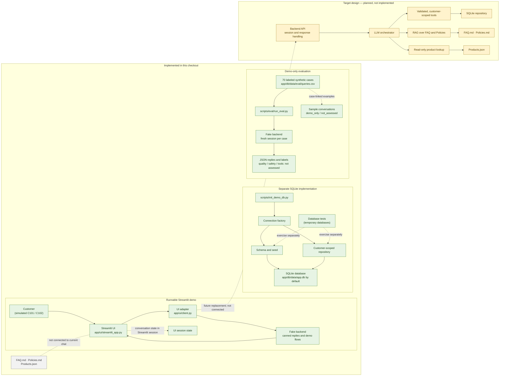

> **Superseded diagram.** The diagram below shows the earlier fake-backend wiring and is kept for history only. The current system is: Streamlit UI -> `app.backend` -> orchestrator -> nine customer-scoped tools -> SQLite, with Chroma retrieval over `FAQ.md` and `Policies.md`, an LLM adapter (OpenAI Responses live-evaluated; Anthropic mock-tested; offline rule-based stand-in), and an optional LiveKit voice channel. See `docs/technical_report.md` section 2.

# Project Architecture

> **Update (branch `wire-ui-backend`):** the Streamlit UI now reaches the real
> backend through `app/ui/client.py` (`UI_BACKEND=real`, the default); the
> diagram and text below still describe the earlier fake-backend wiring, which
> remains available with `UI_BACKEND=fake` and is what the evaluation runner and
> Docker image still use. Person B to redraw the diagram and revise the report.

This diagram distinguishes the current implementation from the target design.
The target design is not implemented in the runnable chat.

## Reading the diagram

- **Implemented** shows the paths present in source. The chat is wired only to
  the fake backend; it does not query SQLite or the supplied knowledge files.
- The database implementation is separate. Its initializer, schema, seed,
  repository, and tests operate independently from the Streamlit conversation.
- The evaluation runner exercises the fake backend, emits expected labels and
  replies, and does not observe tool calls or assess answer quality or safety.
- **Target design** summarizes planned components. It is not evidence that an
  LLM, RAG pipeline, tool layer, or backend API is available in this checkout.
  See [`03_backend_architecture.md`](./03_backend_architecture.md), a design
  draft whose proposed backend implementation does not yet exist.
