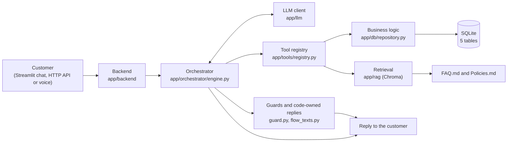

# Architecture

How the assistant is built and why. For the file-level handover see [PROJECT_HANDOVER.md](PROJECT_HANDOVER.md); for the
original design records see [01_database_design.md](01_database_design.md) and [03_backend_architecture.md](03_backend_architecture.md).
The earlier prototype diagram is kept in [history/architecture_prototype.md](history/architecture_prototype.md).

## The one-sentence design

**The language model proposes; code decides.** The model can only suggest a tool call, some text, and a label. Everything that
reads customer data, writes a record, chooses a language or states a fixed sentence is done by deterministic code that
validates the proposal first.

## Request path

| Stage | What it does | Where |
|---|---|---|
| **Customer** | Signs in through a simulated selector; the chat can also arrive over FastAPI or LiveKit voice | `app/ui`, `app/backend/http_api.py`, `app/voice` |
| **Backend** | The only module a front end imports. Holds in-memory sessions; the `ConversationState` handle is a bearer credential. Pending actions expire after 10 minutes and are claimed once | `app/backend` |
| **Orchestrator** | Runs the tool loop, validates every model proposal, owns every state change, confirmation, expiry and cancellation | `app/orchestrator/engine.py` |
| **LLM** | OpenAI Responses (live-evaluated, `gpt-4o-mini`, temperature 0.2), Anthropic (mock-tested only) or the offline `RuleBasedLLM` stand-in. A misconfigured provider raises an error; it never falls back silently | `app/llm` |
| **Tool registry** | Ten tools. No schema contains a customer ID: the customer comes from the session | `app/tools/registry.py` |
| **Business logic** | Every repository function takes the authenticated customer ID and filters on it in SQL. Writes use `BEGIN IMMEDIATE` and re-check eligibility inside the transaction | `app/db/repository.py` |
| **Database and retrieval** | SQLite (customers, orders, order items, return requests, support tickets); Chroma vector index over the FAQ and policies with OpenAI `text-embedding-3-small` | `app/db`, `app/rag` |
| **Response** | Either the model's prose after the guards have checked it, or a fixed sentence chosen by code in the customer's language | `app/tools/flow_texts.py` |

The ten tools: `list_my_orders`, `get_order_status`, `get_my_returns`, `get_my_tickets`, `get_refund_policy`,
`check_return_eligibility`, `lookup_product`, `search_policies`, `start_return_request`, `start_support_ticket`.

## Controls, and why each exists

### Authorization
- **What:** identity comes from the signed-in session only. The repository filters on it in SQL, so a customer's query cannot
  return another customer's rows. An order that does not exist and an order that belongs to someone else return the same
  `not_found` payload.
- **Why:** a prompt can be talked around; a `WHERE customer_id = ?` cannot. Removing the customer ID from every tool schema means
  there is nothing for a model (or an injected instruction) to get wrong.

### Writes need explicit confirmation
- **What:** a return or ticket is created only after a Confirm decision on a pending action bound to the session. The return
  reason stored is the customer's own message, exactly, never the model's paraphrase.
- **Why:** the assistant must never claim an action happened that did not, and must never act on a model's guess.

### Named orders are looked up by code
- **What:** if the customer typed an order ID and the model ignored it, code looks it up once through the customer-scoped tool.
  If it is not on the account, the reply is fixed text that offers, but never lists, the customer's own orders.
- **Why:** live evaluation showed the model refusing or listing orders instead of checking. Code removes the dependence on
  model behaviour here.

### Ambiguity handling
- **What:** when the customer typed no order ID, named a product, and two or more of their own orders hold it, the engine asks
  which order (IDs and statuses only) **before any tool of the model's response runs**. The same rule covers status and refund
  lookups, listings, eligibility checks, returns and tickets. A repeat complaint with several orders and none named gets a
  code-owned list and a question.
- **Why:** an earlier version let the model look up every candidate, which put each order's full record in front of the model
  and possibly the customer. Asking first means nothing is read or shown until the customer chooses.

### Safety guards on the model's wording
- **Refund wording:** a sentence promising a refund, or saying one arrived or is complete, is replaced by the status said
  plainly (Pending, Processed or Failed). "Completed" is a return-request status, not a refund status.
- **Durations:** a time period that no tool result or policy passage supplied is removed. Only verified sources count: tool
  results this turn and durations already verified in the session. The customer's words and the assistant's own prose never
  establish a duration.
- **Contact details and success claims:** the evaluation checks for invented contact details and false success claims, and
  the placeholder `support@example.com` in the source documents is never presented as a real channel.
- **Why:** these are the failure modes that cost a real customer money or trust, and they are cheap to detect in code.

### Language detection
- **What:** the customer's latest message decides the language by code (`guard.decisive_language`, `customer_language`):
  English, Hinglish (Hindi in Latin letters) or Hindi (Devanagari). A one-line per-turn instruction tells the model. Every fixed
  sentence (107 in one catalogue) is chosen by code from the session language.
- **Why:** the model tended to follow earlier turns rather than the latest message, and fixed sentences were English for
  Hindi-speaking customers. One catalogue with a test that each key has three languages keeps them in step. The Hinglish and
  Hindi wording is **draft pending human review**; see [localization_review_hinglish_hindi.md](localization_review_hinglish_hindi.md).

### Ticket scope
- **What:** before a support-ticket card is built, code checks that the text is about an order, product, delivery, payment, refund or return, or a store service request. Personal, relationship, coaching, general-knowledge and coding requests get a fixed refusal and no card; unclear ones get a fixed clarifying question. The card, Confirm and Cancel, expiry, single-use claim and write validation are unchanged.
- **Limitation:** The ticket-scope gate (`guard.ticket_scope`) is vocabulary-based: it recognises store complaints from word lists, so unusual wording can be asked a clarifying question instead of getting a card, and it has **not yet passed independent held-out validation** (protocol: `tests/data/ticket_scope_heldout.md`; the 190 regression tests in `tests/test_ticket_scope_gate.py` are the tuning set).

### Policy controls
- **What:** FAQ and policy answers come from retrieved passages (`search_policies`), not from the model's memory. Return windows
  come from `reason_category`: 48 hours for damaged and wrong-product items, 168 hours for standard returns, inclusive. Retrieval
  is a separate provider requirement from the LLM: production needs `OPENAI_API_KEY` even in offline mode, and there is no silent
  fallback.
- **Why:** policy is the source of truth in `app/db/data/source/`; the model should quote it, not invent it.

### Usage tracking (evaluation only)
- **What:** `scripts/eval/usage_ledger.py` records every provider request (embeddings included) as reserved, sent and
  outcome, before it goes out. It is fail-closed, keeps a cumulative ceiling and treats an unknown prior usage as unknown, never
  as zero. A harness-only retry re-sends only requests that failed before transmission.
- **Why:** an earlier evaluation could not show that its call ceiling had been respected. The ledger fixes the accounting, not
  the model, and it never touches the product path.

## Data and boundaries

- Money is integer paise; timestamps are UTC text `YYYY-MM-DDTHH:MM:SSZ`; return and ticket text is validated exactly and
  never modified.
- Three connection factories; only the initialization factory can create a database, and it refuses the legacy
  `app/db/data/app.db`. Normal startup never creates a database; the health check reports `not_initialized` until the seed
  command has run.
- Sessions and UI chat history are in memory and single-process. The login is simulated and is not production authentication.

## Not covered

The ambiguity guards act on tool calls: a model that describes an order without calling a tool is not caught. Voice has never
been run live. See the limitations in [evaluation/EVALUATION_REPORT.md](evaluation/EVALUATION_REPORT.md) section 11.
